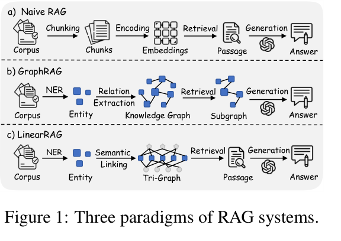
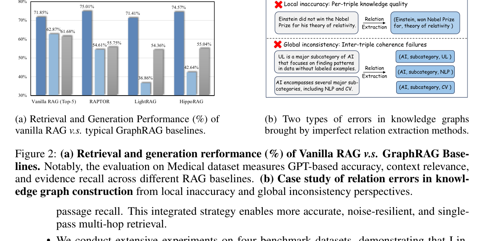
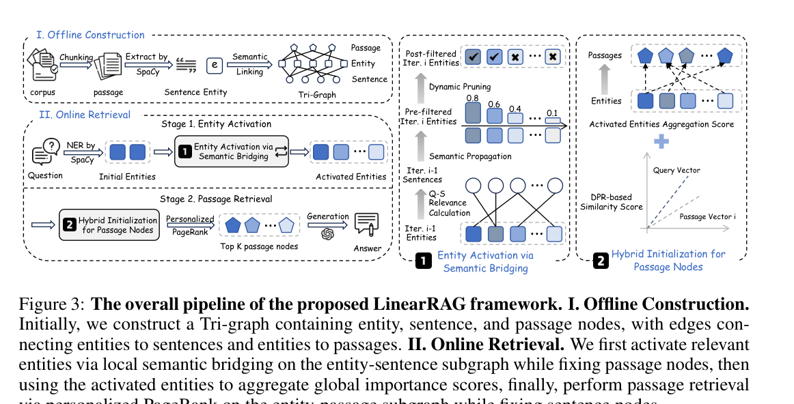
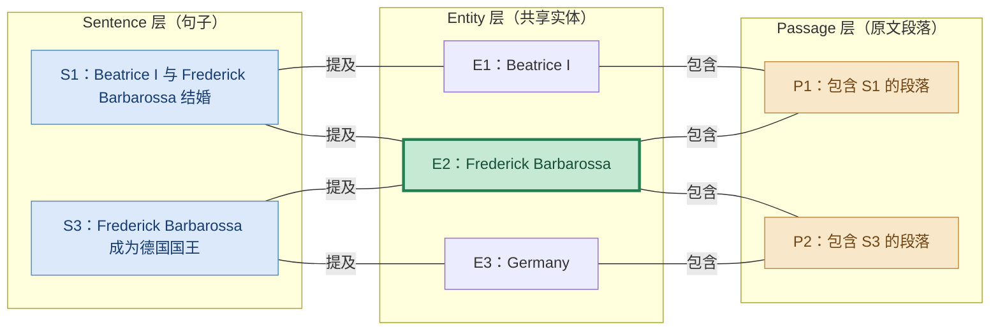

# LinearRAG

### 总体流程

LinearRAG 的核心思路是：**不从语料中抽取实体—关系—实体三元组，而是保留 Passage 原文，以实体作为不同文本之间的桥梁。** 建图阶段将语料整理为 **Passage / Sentence / Entity** 三类节点，通过实体出现关系生成两张稀疏二部图；检索阶段先在 Sentence–Entity 图中激活多跳相关实体，再在 Passage–Entity 图中用混合初始化和 **Personalized PageRank（PPR）** 找出最终证据段落，交给 LLM 生成答案。

可以分成三件事：

1. **用原文组织知识**：轻量 NER 找到实体，连接“哪个句子提到了哪个实体”和“哪个 Passage 包含哪个实体”；
2. **用句子寻找多跳桥梁**：将查询与句子的语义相似度作为传播权重，使查询没有直接提及的中间实体也获得激活分数；同时通过阈值剪枝抑制噪声扩散。
3. **用全局图排序证据**：融合查询–Passage 语义相似度、激活实体的得分与出现频次，初始化 Passage–Entity 图上的节点重要性，经 PPR 排序后取 Top-k 原文。



### LinearRAG 与传统 GraphRAG 的区别

传统三元组知识图谱通常写成：

```text
实体 A ──关系 r1──→ 实体 B ──关系 r2──→ 实体 C

例如：
Beatrice I ──配偶──→ Frederick Barbarossa ──国籍──→ Germany
```

LinearRAG ：

```text
Passage P1：Beatrice I ... married Frederick Barbarossa ...
    ├── 包含实体 → Beatrice I
    └── 包含实体 → Frederick Barbarossa

Sentence S1：Beatrice I ... married Frederick Barbarossa ...
    ├── 提及实体 → Beatrice I
    └── 提及实体 → Frederick Barbarossa

Passage P2：Frederick Barbarossa ... King of Germany ...
    ├── 包含实体 → Frederick Barbarossa
    └── 包含实体 → Germany

Sentence S2：Frederick Barbarossa ... King of Germany ...
    ├── 提及实体 → Frederick Barbarossa
    └── 提及实体 → Germany
```

实体 **Frederick Barbarossa** 同时出现在两组原文里，于是成为跨 Passage 的潜在信息桥梁。系统先沿 **Entity → Sentence → Entity** 发现这条桥，再经 **Entity → Passage** 召回原文，由 LLM 阅读上下文来理解具体关系。



论文 Figure 2 指出两种典型风险：**局部错误**是把某句话中的否定/限定信息抽错为肯定三元组，**全局不一致**是不同片段局部抽取出的关系缺乏统一协调。LinearRAG 选择不在建图时预先判定这些谓词关系，而保留原句供后续推理。

### 完整流程

**建图：语料 → 三类节点与两张稀疏矩阵；检索：局部实体激活 → 全局段落排序 → LLM。**



按照真实的数据依赖，可整理为：

```text
【建图】
原始语料 Corpus
    ↓
切分为多个 Passage（文本段落/Chunk）
    ↓
Passage 按标点拆为 Sentence
    ↓
使用 spaCy 等轻量 NER 抽取 Entity，并做实体关联
    ↓
生成 Tri-Graph（3 种节点，2 类边）
    ├── Passage–Entity → 包含矩阵 C
    └── Sentence–Entity → 提及矩阵 M
    ↓
稀疏保存 C、M；准备实体/句子/段落的语义表示
    ↓
索引完成（无需 LLM 三元组抽取）

【检索：Stage 1，局部语义桥接】
用户问题 q
    ↓
NER 得到查询实体 Eq
    ↓
逐个匹配图中的实体 → 初始激活向量 a⁽⁰⁾
    │
    ├── 计算 q 与所有 Sentence 的相似度 → σq
    │
    └── 迭代实体传播：
         a⁽ᵗ⁾ = MAX[Mᵀ(σq ⊙ (M a⁽ᵗ⁻¹⁾)), a⁽ᵗ⁻¹⁾]
                      ↓
                 动态阈值剪枝
                      ↓
              激活实体 Ea 及其分数

【检索：Stage 2，全局重要性聚合】
查询 q、激活实体 Ea、Passage–Entity 矩阵 C
    ↓
Passage 初始分数：语义相似度 + 实体证据贡献
Entity 初始分数：上一阶段得到的激活分数
    ↓
在 Passage–Entity 二部图上运行 PPR / 重要性传播
    ↓
按最终 Passage 分数排序
    ↓
选 Top-5 Passage 原文（实验设置）
    ↓
GPT-4o-mini 生成答案（实验设置）
```

---

# 一、建图

## 1. 建图一：把原始语料划分为 Passage

**输入：** 原始文本集合 Corpus。 
**处理：** 先获得 Passage 集合，之后才进行句子拆分与实体抽取。

记：

$$
\boxed{\mathcal P=\{p_1,p_2,\ldots,p_{N_p}\}}
$$

其中，每个 $p_i$ 是一个保留原文内容的 Passage。**没有指定唯一的分块算法、分块 token 数或重叠长度**；第 3.1 节以已经得到的 Passage 集合为起点。

**后续最后召回的仍是这些原文 Passage，不是生成的三元组或实体摘要。**

## 2. 建图二：将 Passage 进一步拆分为 Sentence

论文第 3.1 节使用句号、感叹号等**标点**，把每个 Passage 进一步分成 Sentence。

$$
\boxed{\mathcal S=\{s_1,s_2,\ldots,s_{N_s}\}}
$$

- **Sentence：** 相对短，适合判断查询与局部上下文是否有关，是第一阶段实体传播的桥梁。
- **Passage：** 保留更完整的上下文，是第二阶段评分和最后提供给 LLM 的证据单位。

**本步输出：** Sentence 集合以及 Sentence 到 Passage 的来源记录。

## 3. 建图三：使用 NER 抽取实体并进行语义关联

论文使用轻量 NER（例如 **spaCy**），从文本中抽取实体：

$$
\boxed{\mathcal E=\{e_1,e_2,\ldots,e_{N_e}\}}
$$

示例：

```text
s1：Beatrice I ... married Frederick Barbarossa.
抽取结果：{Beatrice I, Frederick Barbarossa}

s3：Frederick Barbarossa was elected King of Germany.
抽取结果：{Frederick Barbarossa, Germany}
```

- 对句子 S1 提取实体 `{Beatrice I, Frederick Barbarossa}`。

- 对句子 S3 提取实体 `{Frederick Barbarossa, Germany}`。

- 将两次出现的 `Frederick Barbarossa` 对应到同一个实体节点。

- 建立 Sentence–Entity 连接，从而让两个句子通过共享实体产生关联。

**本步输出：** 实体词表 

## 4. 建图四：建立 Tri-Graph 的三类节点

论文第 3 节定义三个节点集合：

$$
V=V_p\cup V_s\cup V_e
$$

- V_p：Passage 节点，每个节点对应一份原文证据。
- V_s：Sentence 节点，每个节点对应一条句子。
- V_e：Entity 节点，供不同句子和段落共享。



**本步输出：** 三类可定位的节点，以及明确的节点类型与原文/实体映射。

## 5. 建图五：建立 Passage–Entity 的包含矩阵 C

根据前面 NER 提取的实体，记录每个 Passage 包含哪些实体，并将这种包含关系保存到矩阵 C 中：包含记为 1，不包含记为 0。

例如，Passage 1 包含 Beatrice 和 Frederick，Passage 2 包含 Frederick 和 Germany，因此两个 Passage 可以通过共享的 Frederick 实体建立间接联系。最终输出包含矩阵 C，供后续第二阶段检索使用，通过实体找到相关 Passage，**并利用 PPR 计算段落的重要性**。

最后输出一个包含矩阵C

## 6. 建图六：建立 Sentence–Entity 的提及矩阵 M

同理，如果 Sentence $s_i$ 提及实体 $e_j$，则记录对应的二值边。论文公式 (2)：

$$
\boxed{
M=[M_{ij}]_{N_s\times N_e},\qquad
M_{ij}=\mathbb I\{s_i\ \text{mentions}\ e_j\}
}
$$

沿用只有两句的简化示例：

```text
s1：Beatrice ... Frederick ...
s2：Frederick ... Germany ...
```

$$
\boxed{M=\begin{bmatrix}1&1&0\\0&1&1\end{bmatrix}}
$$

最后输出提及矩阵M

## 7. 建图七：稀疏保存图和语义向量

C 和 M绝大多数位置为 0：一个句子只提到很少实体，一个 Passage 也只包含有限实体。论文明确使用 **Sparse Matrix（稀疏矩阵）** 存储

此外，在线阶段必须能够计算：

$$
\mathrm{sim}(e_q,e_i),\qquad
\mathrm{sim}(q,s_i),\qquad
\mathrm{sim}(q,p_j)
$$

所以实现时需要让 **Entity、Sentence、Passage** 能够被语义编码或进行相似度检索。论文第 4.1 节统一使用 **`all-mpnet-base-v2`** embedding 模型将 Entity、Sentence、Passage 转换为可以计算语义相似度的向量，为后续检索做准备。

**本步输出：** $C$、$M$ 稀疏索引，以及可用于相似度计算的语义表示。

## 8. 建图八：增量加入新 Passage

1. 为 $p_{new}$ 分句，得到新 Sentence。
2. 用 NER 提取新文本出现的 Entity，关联到已有实体节点或新增节点。
3. 向 C 追加新 Passage–Entity 非零关系。
4. 向 M 追加新 Sentence–Entity 非零关系。
5. 为新增内容准备所需语义表示；维护新增节点和原文的映射。

---

# 二、检索第一阶段

## 1. 检索一：从问题中提取初始实体

**输入：** 用户问题 q。

论文使用 spaCy 对问题执行 NER：

$$
\boxed{E_q=\mathrm{NER}(q)}
$$

**本步输出：** 查询实体集合 $E_q$。当用户问题无法通过 NER 提取出任何实体时，**LinearRAG 就跳过基于实体的图检索，改用传统的稠密向量检索（Dense Retrieval）**：将问题转换为语义向量，与语料库中的 Passage 向量计算相似度，直接找出最相关的段落。

## 2. 检索二：查询实体与图库实体对齐，生成初始激活向量

1. 匹配图中实体：将每个查询实体与 Tri-Graph 中已有的实体进行语义相似度比较，找到最相似的实体节点，每个查询实体分别选取一个最相似的图实体。
2. 设置初始分数：将匹配得到的相似度作为该实体节点的初始激活分数，例如 `Beatrice I = 0.90`。
3. 初始化其他实体：图中没有被匹配到的实体（例如 Frederick、Germany），初始激活分数均设为 0。
4. 生成激活向量：按照图中实体的固定顺序（建图时为entity分配的下标），将所有初始分数组成一个向量，供后续语义传播使用。

本步输出： 初始实体激活向量。后续将通过 Sentence–Entity 图进行语义传播，进一步激活与问题相关的其他实体。

## 3. 检索三：计算 Query–Sentence 语义相关性向量

1. 获取用户问题：读取完整的查询问题 q。
2. 计算语义相似度：将问题与语料库中的每个 Sentence 分别进行语义相似度比较。
3. 记录相似度分数：为每个 Sentence 保存对应的相似度，例如 S1 = 0.80，S2 = 0.80。
4. 生成句子相关性向量：按照 Sentence 的固定编号顺序，将所有相似度分数组成一个向量。
5. 用于后续实体激活：通过前面构建的 Sentence–Entity 矩阵 M，将句子相关性与实体之间的连接关系结合起来，指导后续语义传播。

本步输出： 所有 Sentence 与完整用户问题的语义相似度分数。

## 4. 检索四：利用Sentence–Entity 矩阵 M 进行实体激活

1. 获取实体激活分数：读取检索二的所有 Entity 的激活分数。
2. 实体 → 句子：利用矩阵 M，将实体的激活分数传递给包含这些实体的 Sentence，并累加每个句子收到的分数。
3. 句子相关性加权：根据每个 Sentence 与用户问题的语义相似度，调整句子获得的分数。
4. 句子 → 实体：利用矩阵 M 的转置，将加权后的句子分数传递给句子中提及的 Entity，并累加。
5. 更新实体分数：将每个实体的新分数与上一轮分数比较，保留较大值。

本步输出： 更新后的实体激活分数，用于下一轮语义传播或后续剪枝。

## 5. 检索五：多轮语义传播

1. 准备下一轮输入：使用上一轮更新后的实体激活分数。
2. 重复传播过程：次执行“实体 → 句子 → 相关性加权 → 实体”的流程。
3. 更新实体分数：将本轮新分数与上一轮分数比较，保留较大值。
4. 发现中间实体：通过多轮传播，逐步激活问题中没有直接提及但可能相关的实体。

例如：

```
初始实体：Beatrice I
       ↓
第一轮：通过 Sentence S1
       ↓
激活 Frederick Barbarossa
       ↓
第二轮：通过 Sentence S2
       ↓
激活 Germany
```

本步输出： **多轮传播后得到的相关实体及其激活分数。****这里的本质是：通过已经找到的实体，发现更多与问题相关的实体，实现多跳检索**

## 6. 检索六：动态剪枝

动态剪枝是在每一轮传播过程中执行的，采用以下策略：

1. 设置剪枝阈值：为新激活实体设置最低分数要求。
2. 筛选新激活实体：每轮传播后，只允许超过阈值的新实体继续参与下一轮传播。
3. 过滤无关实体：低于阈值的新实体不再作为后续传播的有效种子，减少无关扩展。
4. 判断终止条件：当没有新的实体超过阈值时，停止传播；**论文指出传播轮数通常不超过 4 轮。**
5. 整理最终结果：保存最终激活的相关 Entity 及其分数，交给第二阶段 Passage 检索。

本步输出： **最终激活实体集合及其相关性分数。**

---

# 三、检索第二阶段

## 1. 检索一：切换至 Passage–Entity 图

1. 第一阶段已经得到相关 Entity 及其最终激活分数。
2. 停止使用 Sentence–Entity 矩阵 M，改用 Passage–Entity 矩阵 C。
3. 根据矩阵 C，确定每个 Entity 与哪些 Passage 存在包含关系。

**本步输出：** Passage–Entity 图及第一阶段得到的实体激活结果。

## 2. 检索二：计算 Query–Passage 语义相似度

1. 获取完整的用户问题 Query。
2. 将 Query 与语料库中的每个 Passage 进行语义相似度比较。
3. 记录每个 Passage 与 Query 的语义相似度分数。

**本步输出：** 所有 Passage 与用户问题的直接语义相似度分数。

## 3. 检索三：统计激活实体在 Passage 中的出现次数

1. 获取第一阶段最终激活的 Entity 集合。
2. 遍历 Passage，统计每个已激活 Entity 在其中出现的次数。
3. 保存统计结果，作为后续 Passage 初始评分的依据。

**本步输出：** 每个 Passage 包含的已激活实体及其出现次数。

## 4. 检索四：计算 Passage 的混合初始重要性分数

1. **获取直接语义分数**：读取检索二得到的 Query–Passage 语义相似度。
2. **获取实体信息**：读取检索三得到的实体出现次数，以及第一阶段得到的实体激活分数。
3. **计算实体贡献**：综合考虑实体激活强度、出现次数和实体层级权重，计算每个 Passage 的实体证据分数。
4. **融合两类分数**：按照论文的加权规则，将直接语义分数与实体证据分数结合，并应用 Passage 节点权重，得到初始重要性分数。

**本步输出：** 每个 Passage 的混合初始重要性分数。

## 5. 检索五：初始化 Entity 节点的重要性分数

1. 获取第一阶段最终激活的 Entity 及其激活分数。
2. 将每个 Entity 的激活分数直接作为其初始重要性分数。
3. 未激活实体的初始分数为 0。

**本步输出：** 所有 Entity 的初始重要性分数。

至此，Entity 和 Passage 两类节点均已完成初始化，可以进入 PPR 全局传播。

## 6. 检索六：使用 PPR 计算全局重要性

1. **获取初始分数**：读取检索四和检索五得到的 Passage、Entity 初始重要性分数。
2. **传播重要性**：在 Passage–Entity 图中，每个节点根据其连接关系，将分数分配给相邻节点。
3. **更新节点分数**：每个节点汇总邻居传递的分数，并结合阻尼系数更新自身的重要性。
4. **迭代传播**：重复分数传播和更新，得到图中各节点的全局重要性分数。

**本步输出：** 经过 PPR 传播后的 Passage 和 Entity 重要性分数。

## 7. 检索七：选取 Top-K Passage

1. 获取上一步计算得到的所有 Passage 最终重要性分数。
2. 按照分数从高到低排序，只对 Passage 节点进行排名。
3. 选取排名最高的 K 个 Passage，论文实验采用 Top-5。
4. 根据 Passage 编号获取对应的原始文本。

**本步输出：** 最相关的 Top-K Passage 原文。

## 8. 检索八：LLM 生成最终答案

1. 获取用户原始问题 Query。
2. 获取检索七返回的 Top-K Passage 原文。
3. 将用户问题和检索结果组织成 Prompt。
4. 调用 LLM，根据原文证据进行推理并生成最终答案。

**本步输出：** 用户问题的最终回答。

**核心区别：第一阶段使用 Sentence–Entity 图寻找相关实体；第二阶段使用 Passage–Entity 图，结合语义相似度、实体证据及 PPR 找到最重要的原文。**
