# MG²-RAG：多粒度多模态图检索增强生成

## 总体流程

**MG²-RAG 的核心思路：通过文本实体定位图像中的具体物体，将实体与视觉区域封装成统一多模态节点；再以 Chunk、Image 和统一多模态节点组成知识图谱，先进行四种粒度的语义检索，再利用图传播确定最相关的文档证据。**

这篇论文包含两个主模块：**Hierarchical Multimodal Knowledge Graph Construction（分层多模态知识图谱构建）** 和 **Multi-Granularity Graph Retrieval（多粒度图检索）**。前者处理多模态语料并建立图索引；后者根据用户的文字、图片查询激活相关节点，传播关联性，最后取回证据供多模态大模型生成回答。

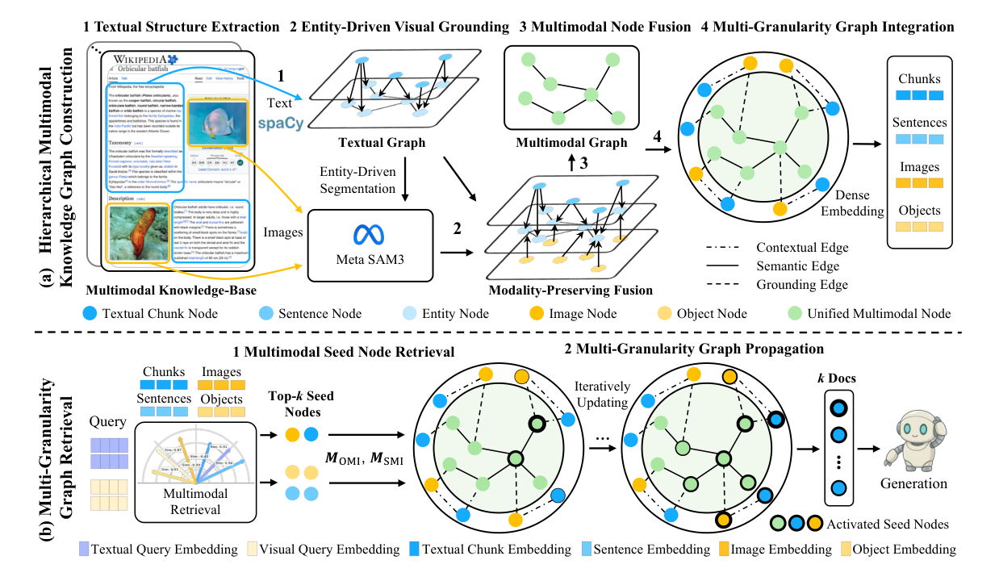

## 主要解决的任务

传统多模态检索常将每段文字与每张图片分别编码后进行向量检索，得到的结果偏向彼此独立的证据。**已有的图方法则经常让多模态模型把图片内容改写成文字，再据此抽取知识关系。**MG²-RAG 采用更直接的视觉定位路线：文本中的实体名称成为 SAM3 的视觉提示词，相关图像区域会被提取出来，并与文本实体对应。**这样既保留原文对应的语义，又让原始图像区域参与后续检索。**

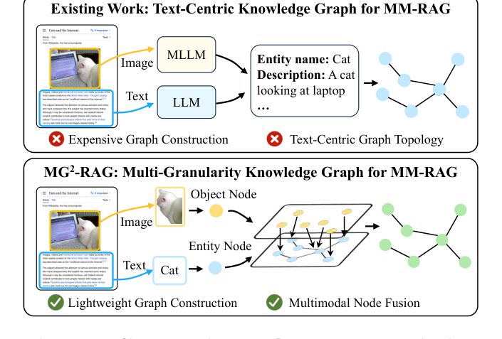

### 总体流程

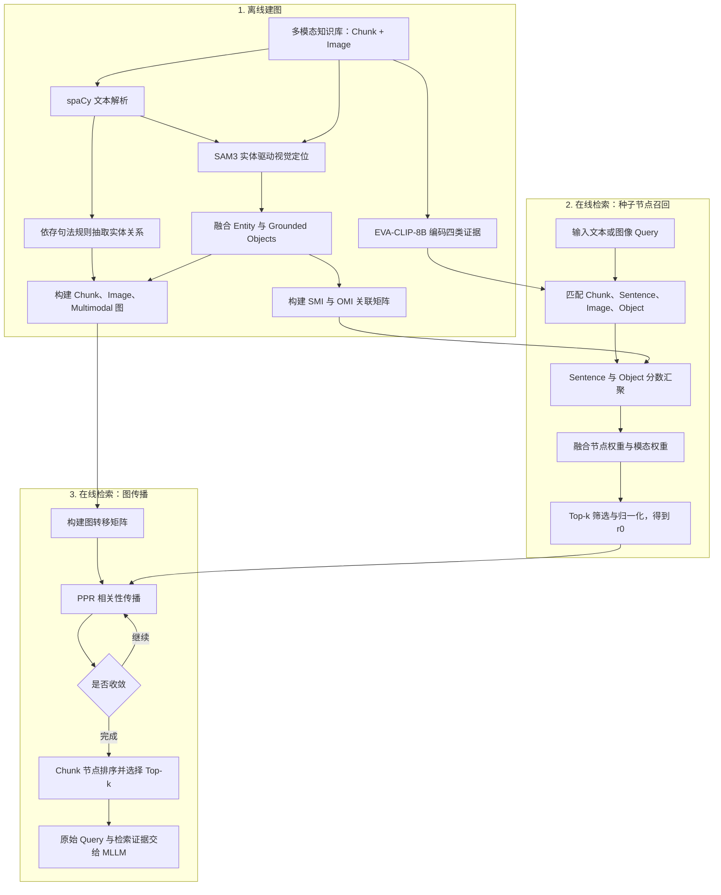

---

# 一、建图

## 1. 建图一：组织多模态知识库

**输入：** 文档块 `Chunk` 及其关联图片。论文将知识库表示成多个 `(c_k, I_k)` 单元，其中 `c_k` 为一段文本，`I_k` 为该文本关联的一组图片。

**处理过程：**

1. 将语料组织为若干文本块，为每个块保留唯一编号和原始内容。
2. 为文本块维护与其对应的图片列表，保存图片原始数据与来源关系。

**输出：** 文本块集合、图片集合、Chunk—Image 来源映射。

## 2. 建图二：从 Chunk 提取 Sentence 与 Entity

**使用模型：** spaCy `en_core_web_trf`

**处理过程：**

1. 逐个读取 Chunk，使用 spaCy 进行分句，得到本地 Sentence 列表。
2. 对句子执行命名实体识别（NER），获得对应的 Entity 列表。
3. 汇总所有 Chunk 的 Sentence 和 Entity，并记录句子所属 Chunk 与实体出现的位置。
4. **保留模型生成的依存句法树及词性标记（POS**）

**本步输出：** 全局 Sentence 集合、Entity 集合、分句来源记录及依存句法分析结果。

## 3. 建图三：利用依存句法提取实体关系

**输入：** 每条句子的实体及依存句法树。基于**语言规则的关系**抽取实体关系。

**处理流程：**

1. 逐句读取实体，筛选关系候选实体。 **`ORDINAL`、`CARDINAL`、`PERCENT`、`QUANTITY` 这四类属性类标签排除在关系候选集合之外。**模型中提供的标签如下：

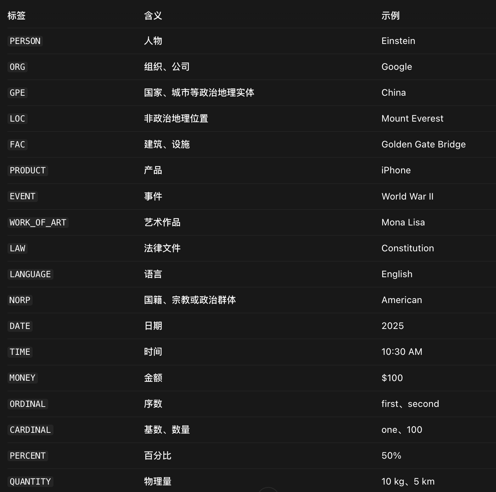

2. 对拥有至少两个候选实体的句子，依次检查每一对实体。

3. 检查实体的依存根词、语法角色以及连接路径，并匹配动词中心或名词中心的规则。

4. 从匹配到的语法结构中抽取关系谓词，必要时结合介词形成复合谓词。

5. 将谓词转换成词元（lemma）形式；针对被动句调整实体顺序，形成规范化关系。

6. 将关系映射到对应的实体节点之间，供后续建立语义边。

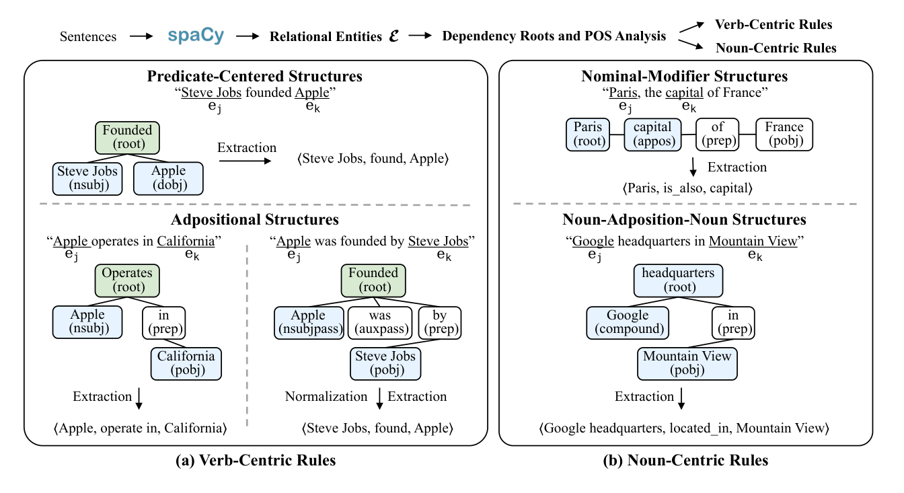

| 规则                  | 原始句子                             | 处理方式                                             | 输出三元组                                         |
| --------------------- | ------------------------------------ | ---------------------------------------------------- | -------------------------------------------------- |
| 1. 谓语中心结构       | Steve Jobs founded Apple             | 识别 Jobs 为主语、Apple 为宾语，提取动词 founded     | `<Steve Jobs, found, Apple>`                       |
| 2. 介词结构           | Apple operates in California         | 提取动词 operates 与介词 in，形成复合关系            | `<Apple, operate in, California>`                  |
| 3. 名词修饰结构       | Paris, the capital of France         | 通过 appos（同位语）识别 Paris 与 capital 的描述关系 | `<Paris, is_also, capital>`                        |
| 4. 名词—介词—名词结构 | Google headquarters in Mountain View | 根据介词 in 识别地点关系                             | `<Google headquarters, located_in, Mountain View>` |

`Steve Jobs founded Apple.`（乔布斯创立了苹果公司）为例：

1. 提取实体：NER 识别出 `Steve Jobs` 和 `Apple`，过滤指定的数值类实体。
2. 组成实体对：得到 `(Steve Jobs, Apple)`，准备判断两者之间的关系。
3. 分析语法结构：通过依存句法树发现，`Steve Jobs` 是主语，`Apple` 是宾语，两者都与动词 `founded` 关联。
4. 提取关系：根据主语—谓语—宾语规则，确定关系为 `founded`（创立）。
5. 规范化关系：将 `founded` 还原为词元 `found`，统一关系名称。
6. 建立语义边：在知识图谱中连接两个实体对应的节点，关系为 `found`。

**输出：** 实体间的规范化语义关联。其用途是建立图中的 **Semantic Edges**。

## 4. 建图四：使用 Entity 驱动图像区域定位

**输入：** Chunk 中识别出的实体名称与该 Chunk 关联的图片。**使用模型：** SAM3 开放词汇分割模型

**处理过程：**

1. 读取 Chunk 的实体列表 `E_k` 与图片列表 `I_k`。
2. 将实体名称组成视觉定位提示词，并批量送入 SAM3。
3. SAM3 在关联图片中搜索与实体名称对应的视觉区域，得到 Object 区域和定位置信度 `σ`。
4. 根据阈值 `τ` 筛选有效分割结果，保留每个 Object 的来源图片以及实体关联。
5. 对同一实体收集其在关联图片中获得的全部**有效 Object 区域**。

**输出：** `Entity → {Object 区域及置信度、来源 Image}` 映射。

由于一个文档可能包含多张图片，而每张图片又包含多个局部对象。实体驱动的视觉定位可以将文本中真正被提及的对象与图像中的具体区域对应起来，为细粒度跨模态证据检索提供基础。

## 5. 建图五：融合 Entity 与 Object 为统一多模态节点

**输入：** Entity 及对应的 SAM3 有效区域。**核心结构：** `Unified Multimodal Node`。

**处理过程：**

1. 为每个获得有效视觉检测结果的实体，收集其关联 Object 集合。
2. 将实体名称与这些 Object 组合成统一多模态节点 `v_m = (e, V_o^e)`。
3. 节点内部保留实体语义以及各个视觉区域的独立来源。
4. 将这些统一多模态节点汇总为统一多模态节点集合 `V_M`。

**输出：** 统一多模态节点集合 `V_M`，每个节点体现文本实体及其视觉证据之间的绑定关系。

## 6. 建图六：建立两张多模态关联矩阵

**第一张：Sentence–Multimodal Incidence Matrix，记作 `M_SMI`。** 行对应 Sentence，列对应 Unified Multimodal Node。当句子提及该节点关联的 Entity 时，矩阵对应位置为 1。

**第二张：Object–Multimodal Incidence Matrix，记作 `M_OMI`。** 行对应 Object，列对应 Unified Multimodal Node。当某 Object 属于相应多模态节点时，矩阵对应位置为 1。

| 矩阵 | 行 | 列 | 关联信息 | 在线用途 |
|---|---|---|---|---|
| `M_SMI` | Sentence | Multimodal Node | 句子提及节点对应实体 | 把 Sentence 相似度汇总到统一节点 |
| `M_OMI` | Object | Multimodal Node | 视觉对象属于该节点 | 把 Object 相似度汇总到统一节点 |

**本步输出：** `M_SMI` 和 `M_OMI` 两张二值关联矩阵。

## 7. 建图七：确定图谱中的三种主节点

论文定义的图谱主节点集合为 `V = V_C ∪ V_I ∪ V_M`

| 图节点 | 代表内容 | 承担的角色 |
|---|---|---|
| **Chunk Node** (`V_C`) | 原始文档文本块 | 保存较完整的知识上下文；最终返回的文档证据 |
| **Image Node** (`V_I`) | 原始图片 | 保存完整图像及其来源关系 |
| **Unified Multimodal Node** (`V_M`) | 文本实体与有效视觉区域的组合 | 跨模态桥梁；细粒度关系传播锚点 |

**Sentence 与 Object ：**不作为图节点，但是是向量检索的独立对象，后面会通过**关联矩阵参与统一多模态节点的种子分数计算**。

## 8. 建图八：构造三类图边

**输入：** Chunk、Image、多模态节点、文本关系及视觉定位置信度。

1. **Contextual Edge（上下文边）**：**连接 Chunk 与它关联的 Image；同时连接 Chunk 与该 Chunk 中实体形成的统一多模态节点**。这些边记录信息来源。
2. **Semantic Edge（语义边）**：当两个多模态节点背后的**文本实体存在直接的句法依赖关系时，在对应节点间建立语义边**
3. **Grounding Edge（视觉定位边）**：借助统一多模态节点内包含的 Object，将它与该 Object 来源的 Image 建立定位关系；边权采用 SAM3 置信度 `σ`。

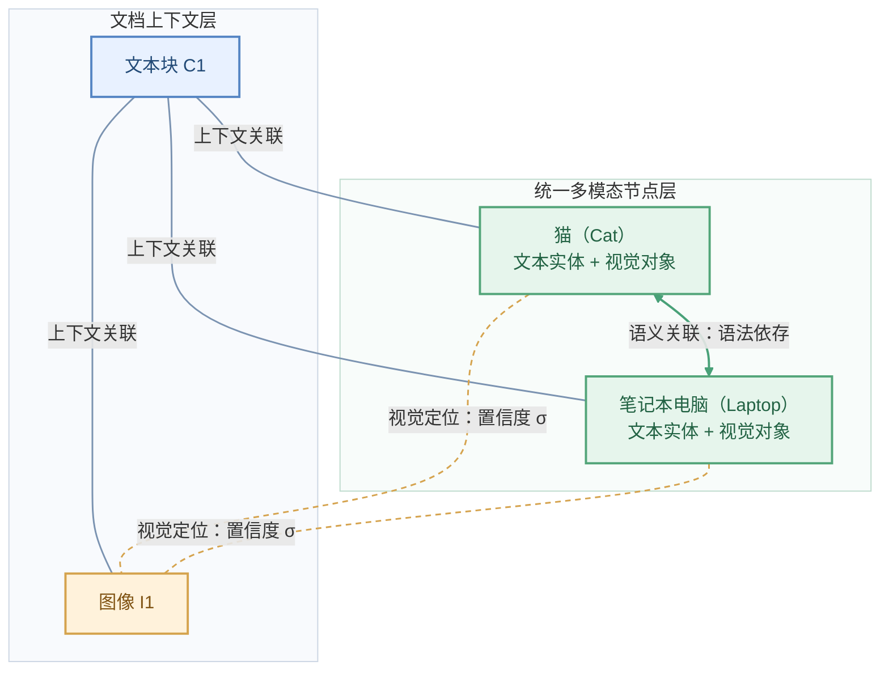

**本步输出：** 异构多粒度图 `G=(V,E_G)`。它保存文本上下文关系、实体间语义关系及实体与视觉区域的定位关系。

## 9. 建图九：为四种检索粒度编码向量

**使用模型：** EVA-CLIP-8B，**四类元素被编码至同一个语义空间；论文说明对向量进行 L2 归一化，并使用余弦相似度。**

| 向量索引 | 内容 | 检索作用 |
|---|---|---|
| `Z_C` | Chunk Embeddings | 在完整文档块层面寻找相关证据 |
| `Z_S` | Sentence Embeddings | 在具体句子层面捕获局部语义 |
| `Z_I` | Image Embeddings | 利用整张图片的视觉信息进行检索 |
| `Z_O` | Object Embeddings | 利用局部视觉区域进行细粒度检索 |

**处理过程：** 逐一编码原始 Chunk、Sentence、Image 和裁剪得到的 Object，并保存向量与原始元素之间的编号映射。检索阶段将对这四组向量分别计算查询相似度

## 10. 建图完成

最终产物如下：

| 组成部分 | 存储的关键数据 | 用途 |
|---|---|---|
| 原文数据 | Chunk、Sentence、Image、Object | 还原证据及其来源 |
| 文本解析结果 | Entity、依存关系及规则抽取关系 | 形成多模态节点的概念和语义边 |
| 统一多模态节点 | `Entity + Grounded Objects` | 跨模态证据融合 |
| 两张关联矩阵 | `M_SMI`、`M_OMI` | 细粒度分数汇聚 |
| 图谱结构 | `V_C`、`V_I`、`V_M` 与三类边 | PPR 图传播 |
| 向量索引 | `Z_C`、`Z_S`、`Z_I`、`Z_O` | 语义检索与种子节点激活 |

# 二、检索第一阶段

## 1. 检索一：接收文字与图片查询

**输入：** 用户文本查询 `q_t`、视觉查询 `q_v`，或两者的组合

**处理过程：**

1. 获取文本查询：例如用户输入“这只猫正在做什么？”
2. 获取图像查询：例如用户上传一张猫使用电脑的图片。
3. 分别进行向量化：
   - 文本 → EVA-CLIP-8B 的文本编码器 → 文本查询向量 \(q_t\)
   - 图片 → EVA-CLIP-8B 的图像编码器 → 图像查询向量 \(q_v\)

**本步输出：** 文本与图片各自查询向量。

## 2. 检索二：在四个粒度上做语义匹配

**输入：** 查询向量及 `Z_C`、`Z_S`、`Z_I`、`Z_O`

**处理过程：**

1. 将文本查询向量与四类元素分别比较，得到 Text→Chunk、Text→Sentence、Text→Image、Text→Object 的相关分数。
2. 将视觉查询向量执行同样的四粒度比较，得到 Vision→Chunk、Vision→Sentence、Vision→Image、Vision→Object 的相关分数。
3. 为每一种查询模态保存四组得分，供后续聚合。
4. 依据各任务配置的 Top-k 值选取高分候选。论文中给出的候选如下：

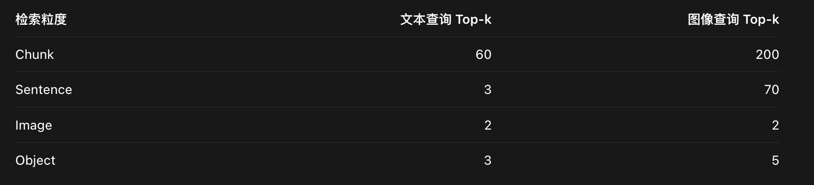

**本步输出：** 八组相似度较高的种子节点。

## 3. 检索三：将 Sentence 与 Object 分数映射到多模态节点

**输入：**（上面八组中由文本和视觉检索得到的） Sentence、Object 的相关性得分，以及 `M_SMI` 和 `M_OMI`。

**处理过程：**

1. 根据 `M_SMI` 找到每个统一多模态节点对应的 Sentence，汇总这些句子的相似度，并通过度数矩阵 `D_S` 执行均值归一化。
2. 根据 `M_OMI` 找到该统一多模态节点包含的 Object，汇总这些视觉区域似度，并通过 `D_O` 完成均值归一化。
5. 将两个来源的归一化得分相加，形成每个统一多模态节点的激活分数。

核心关系可简记为：

$$
\boxed{s_M^{(m)} = D_S^{-1}M_{SMI}^{\mathsf T}s_S^{(m)}+D_O^{-1}M_{OMI}^{\mathsf T}s_O^{(m)}}
$$

**本步输出：** 每种查询模态对应的一组统一多模态节点分数 `s_M`。

## 4. 检索四：合成每种查询模态的图节点分数

**输入：** （上上面八组中由文本和视觉检索得到的）Chunk 得分、Image 得分以及刚刚得到的统一多模态节点得分

**处理过程：**

1. 对 Chunk 得分乘以 `ω_C`，控制整体文档信息的重要程度。（该变量为人为设置）
2. 对 Image 得分乘以 `ω_I`，控制整体图像信息的重要程度。（该变量为人为设置）
3. 保留统一多模态节点的聚合得分。
4. 按照建图阶段已经确定的图节点顺序，分文本查询与视觉查询，将各自的Chunk、Image 和统一多模态节点的相关性分数依次排列，分别形成文本查询向量 \(u^{(t)}\) 和视觉查询向量 \(u^{(v)}\)。后续将文本和视觉查询对该节点的相关性分数进行加权融合。

## 5. 检索五：融合文本与视觉分支，筛选种子节点

**输入：** `u^(t)` 和 `u^(v)`，以及模态权重 `λ_t`、`λ_v`，这里可以不同任务的特点，动态调整模态权重。

**处理过程：**

1. 对文本分支乘以权重 `λ_t`。
2. 对视觉分支乘以权重 `λ_v`。
3. 将两个分支对应图节点的贡献加总，形成初始激活向量。
4. 按 Top-k 设置保留高分种子节点，并把保留分数归一化为可供图传播使用的初始分布 `r_0`。**其中每个向量对应具体的图节点**

$$
\boxed{r_0=\lambda_t u^{(t)}+\lambda_v u^{(v)}}
$$

**本步输出：** `r_0`，高分节点可能来自相关 Chunk、Image 或 Unified Multimodal Node。

**查询模态的权重设计**

| 任务 | 文本权重 `λ_t` | 视觉权重 `λ_v` | 流程含义 |
|---|---:|---:|---|
| E-VQA | 0.1 | 1.0 | 根据问题附图重点定位视觉证据 |
| InfoSeek | 0.1 | 1.0 | 视觉实体识别主导初始检索 |
| ScienceQA | 1.0 | 1.0 | 同时考虑文字描述和图像线索 |
| CrisisMMD-BC | 1.0 | 0.5 | 在二分类中提高文本相关性权重 |
| CrisisMMD-MC | 1.0 | 1.0 | 细类别识别时保留完整视觉贡献 |

# 三、检索第二阶段

## 1. 检索六：根据知识图谱生成传播矩阵

**输入：** 建图得到的三类节点、三类边以及初始分布 `r_0`。

**处理过程：**

1. 根据图谱中节点之间的连接关系，确定相关性分数可以沿哪些边传播。
2. 对节点间的连接权重进行按列归一化，得到转移矩阵 `W`，用于控制每个节点向其他节点传播多少分数。
3. 使用上一阶段得到的种子分布 `r_0`，确定本次查询从哪些节点开始传播，以及各节点的初始重要性。

本步输出： 转移矩阵 `W`（决定如何传播）和种子分布 `r_0`（决定从哪里开始传播）。

## 2. 检索七：执行 PPR 图传播

**处理过程：**

1. 初始化节点分数：使用上一阶段得到的种子分布 `r₀`，为图谱中的每个节点设置初始分数。种子节点具有对应的重要性分数，其余节点初始分数为 0。
2. 沿图传播分数：根据图谱中节点之间的连接关系，将当前节点的分数按照边的权重分配给相邻节点，使相关节点也能获得分数。
3. 融合传播结果：将本轮传播得到的分数与原始种子分布 `r₀` 加权合并，既考虑图中的关联关系，也保留用户查询最初关注的节点。
4. 反复更新分数：将合并后的分数作为下一轮输入，重复传播和融合，使相关性逐渐传递到更多关联节点。
5. 得到最终结果：当连续两轮的节点分数变化足够小时，停止迭代，得到图谱中所有节点的最终重要性分数。

公式：

\[ r_{\ell+1}=\alpha Wr_\ell+(1-\alpha)r_0 \]

其中：

- `r₀`：初始种子分布，记录每个图节点的初始重要性。
- `rₗ`：第 ℓ 轮迭代后，各图节点的重要性分数。
- `W`：图传播矩阵，决定节点之间如何分配分数。
  - `α`：传播权重，控制图谱关联关系对分数的影响。
- `1-α`：初始种子权重，控制每轮保留多少原始查询相关性。

**论文将收敛阈值设置为 \(\varepsilon=10^{-6}\)，用于判断是否停止迭代。**

## 3. 检索八：根据收敛后的 Chunk 分数排序

**输入：** 最终 PPR 节点重要性分布

**处理过程：**

1. 从全体图节点分数中读取 **Chunk Node** 对应的分数，**忽略image节点以及多模态节点。**
2. 按分数从高到低排序。
3. 根据任务设置选取 Top-k Chunk。
4. 根据 Chunk 编号获取对应的原始文本证据，以及必要的来源信息。

**本步输出：** 最相关的 Top-k 文档块，作为下一步生成的主要检索上下文。

## 4. 检索九：构建多模态 Prompt 并调用 MLLM

**输入：** 用户的原始文字、查询图像以及排序后的文档证据。

**处理过程：**

1. 整理检索得到的 Chunk 内容，形成 `Retrieved Context`。
2. 将原始问题、可用的查询图像与检索结果汇合。
3. 根据任务选取问答、科学推理或分类 Prompt 模板。
4. 调用对应的 LLM / MLLM 生成结果。

---

# 实验验证与论文结论

## 1. 实验使用的模型和数据集

| 任务 | 数据集 | 主要评测对象 | 指标 |
|---|---|---|---|
| 多模态检索 | E-VQA、InfoSeek | 检索结果中目标证据的覆盖情况 | Recall@K |
| 知识型视觉问答 | E-VQA、InfoSeek | 利用外部证据回答视觉问题 | E-VQA：BEM；InfoSeek：准确率 / 宽松准确率 |
| 多模态推理 | ScienceQA | 科学问题的多模态推理 | Accuracy |
| 多模态分类 | CrisisMMD | 灾害相关社交媒体内容 | BC、MC、MC-m Accuracy |

**实现配置：** spaCy `en_core_web_trf` 进行文本解析，SAM3 定位视觉区域，EVA-CLIP-8B 计算统一向量；稠密检索和 PPR 在 GPU 上执行。实验使用 **两张 NVIDIA RTX 6000 Ada（每张 48GB）**。（第 9 页）

**对照方法：** VaLiK、mKG-RAG、MMGraphRAG 等图检索框架，以及 EVA-CLIP、CLIP、Nomic-Embed 等向量检索基线。生成阶段还比较了多种 LLM/MLLM 主干。（第 8—13 页）

## 2. 图谱构建效率：Figure 3

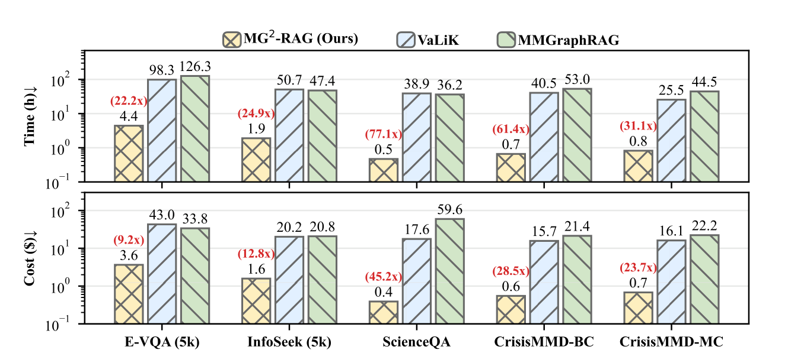

| 数据集或任务 | MG²-RAG 建图耗时 | 图中报告的最高相对加速 | MG²-RAG 建图成本 | 图中报告的最高成本降低倍数 |
|---|---:|---:|---:|---:|
| E-VQA（5k） | 4.4 h | 22.2× | $3.6 | 9.2× |
| InfoSeek（5k） | 1.9 h | 24.9× | $1.6 | 12.8× |
| ScienceQA | 0.5 h | 77.1× | $0.4 | 45.2× |
| CrisisMMD-BC | 0.7 h | 61.4× | $0.6 | 28.5× |
| CrisisMMD-MC | 0.8 h | 31.1× | $0.7 | 23.7× |

论文报告的平均加速为 **43.3×**，平均成本降低倍数为 **23.9×**。这组结果对应图谱构建阶段，成本统计采用 GPU 租赁支出与图谱构建所需模型调用成本相比较的口径。

### 建图规模扩展：Table 1

| E-VQA 知识库规模 | 1k | 5k | 10k | 50k | 100k | 100k（双 GPU） |
|---|---:|---:|---:|---:|---:|---:|
| 建图时间（小时） | 0.6 | 2.9 | 5.7 | 29.7 | 63.4 | 32.8 |

这组数据表明，100k 文档时双 GPU 设置把建图时间从 63.4 h 降至 32.8 h。（第 10 页）

**原文记录提示：** Figure 3 给出 E-VQA（5k）的 4.4 h，而 Table 1 同规模给出 2.9 h。两处属于论文中分别报告的实验数值，阅读和复现实验时应保留相应图表与口径。

## 3. 多模态检索效果：Table 2

| 方法 / 数据集 | R@1 | R@5 | R@10 | R@20 | R@50 |
|---|---:|---:|---:|---:|---:|
| MG²-RAG / E-VQA | **44.9** | **66.4** | **72.0** | **79.4** | **83.9** |
| EVA-CLIP-8B（V→T）/ E-VQA | 42.0 | 62.6 | 69.5 | 75.6 | 83.2 |
| MG²-RAG / InfoSeek | **59.6** | **78.9** | **83.8** | **87.4** | **91.0** |
| EVA-CLIP-8B（V→T）/ InfoSeek | 56.5 | 76.3 | 82.2 | 86.4 | 90.6 |
| mKG-RAG / InfoSeek | 49.7 | 71.6 | 78.0 | 82.5 | 89.1 |

**现象：** 图传播后的多粒度检索在 E-VQA 与 InfoSeek 的各个 Recall@K 位置取得较高结果，尤其 InfoSeek 的 R@1 相较 mKG-RAG 提升 9.9 个百分点。（第 10—11 页）

**规模对应：** 这里的 E-VQA R@1 为 44.9；后续消融实验的 E-VQA（5k）R@1 为 57.8。它们来自不同的语料规模实验设置。

## 4. 知识型视觉问答：Table 3

下面保留具有代表性的结果。全部基线与细分评测列可查原文第 11 页。

| 设置 | E-VQA All | InfoSeek All |
|---|---:|---:|
| Zero-shot GPT-5.2 | 40.30 | 29.29 |
| MG²-RAG + LLaMA-3.1-8B | 47.77 | 32.58 |
| MG²-RAG + Qwen2.5-VL-7B | 48.59 | 35.48 |
| MG²-RAG + Qwen3.5-27B | 52.19 | 37.87 |
| MG²-RAG + GPT-5.2 | **60.30** | **39.30** |
| MG²-RAG（5k）+ Qwen2.5-VL-7B | 53.36 | 38.65 |
| MG²-RAG（5k）+ Qwen3.5-27B | **60.24** | **42.26** |

**解释：** 引入检索证据后，生成模型能够将查询中的视觉指代与知识库中的文档事实对应起来；5k 实验则用于在相同受控语料设置下与较昂贵的图谱基线比较。InfoSeek 还分别报告 Unseen-Q 与 Unseen-E 两个切分。（第 11 页）

## 5. ScienceQA 多模态推理：Table 4

| 方法 | 平均准确率（Avg.） |
|---|---:|
| Human（论文列出的参考值） | 88.40 |
| Qwen2.5-VL-7B | 87.50 |
| GPT-5.2 | 96.30 |
| Qwen3.5-27B | 97.34 |
| MG²-RAG + Qwen2.5-VL-7B | 89.25 |
| MG²-RAG + GPT-5.2 | 97.00 |
| MG²-RAG + Qwen3.5-27B | **97.85** |

原文还按照自然科学、社会科学、语言科学、文本/图片上下文、年级段等维度列出结果。`97.85` 为 MG²-RAG 与 Qwen3.5-27B 搭配的总体准确率。（第 12 页）

## 6. CrisisMMD 多模态分类：Table 5

| 方法 | BC | MC | MC-m | Avg. |
|---|---:|---:|---:|---:|
| Qwen3.5-27B（Zero-shot） | 69.83 | 48.82 | 49.35 | 56.00 |
| GPT-5.2（Zero-shot） | 71.00 | 53.00 | 53.60 | 59.20 |
| MG²-RAG + Qwen2.5-VL-7B | 71.03 | 46.45 | 47.25 | 54.91 |
| MG²-RAG + Qwen2.5-7B | 69.69 | 51.10 | 51.59 | 57.46 |
| MG²-RAG + Qwen3.5-27B | 72.28 | 52.30 | 52.79 | 59.12 |
| MG²-RAG + GPT-5.2 | **72.30** | **56.10** | **56.70** | **61.70** |

BC 关注帖子对灾害响应是否有信息价值；MC 为细粒度人道救援类别；MC-m 为合并部分类别后的设置。论文报告的最佳总体结果是 MG²-RAG + GPT-5.2 的 **61.70**。（第 13 页）

## 7. 消融实验：Table 6

| 方法配置 | E-VQA（5k）R@1 / R@5 | E-VQA（5k）BEM All | ScienceQA Avg. | CrisisMMD Avg. |
|---|---:|---:|---:|---:|
| 完整 MG²-RAG | **57.8 / 83.1** | **60.24** | **97.85** | **59.12** |
| 移除 HGC（分层图构建） | 40.7 / 61.5 | 51.72 | 97.48 | 56.70 |
| 移除 MNF（多模态节点融合） | 43.8 / 78.0 | 55.38 | 97.67 | 58.62 |
| 移除 GP（图传播） | 25.5 / 76.0 | 54.69 | 97.51 | 58.90 |

**对应结论：** HGC 带来多层结构信息；MNF 建立实体与局部视觉对象的直接联系；GP 扩展初始种子之外的结构关联。尤其在 E-VQA（5k）的 R@1 指标上，移除 GP 后降至 25.5，体现了图传播对证据排名的重要作用。（第 14 页）

## 8. 论文案例图：如何体现效果

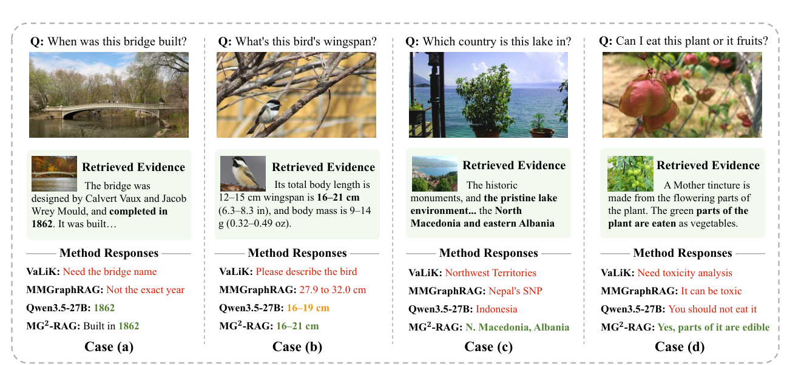

**Figure 4：** 系统将视觉查询与相关文本证据对应起来，例如桥梁建成于 1862 年、鸟类翼展为 16–21 cm；湖泊案例通过检索资料确定与北马其顿和阿尔巴尼亚有关的地点。（第 15 页）

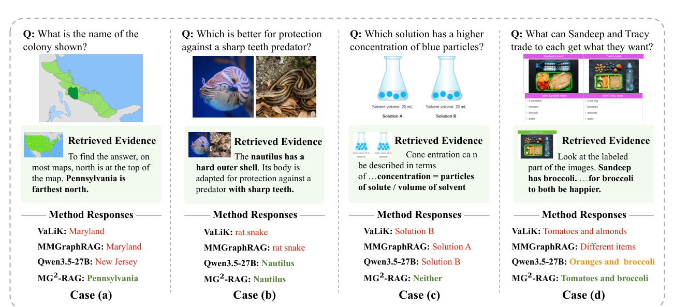

**Figure 6：** 展示地图位置判断、动物保护结构、溶液浓度比较和物品交换推理。方法通过图谱相关上下文辅助理解图片中的场景与问题要求。（第 30—33 页）

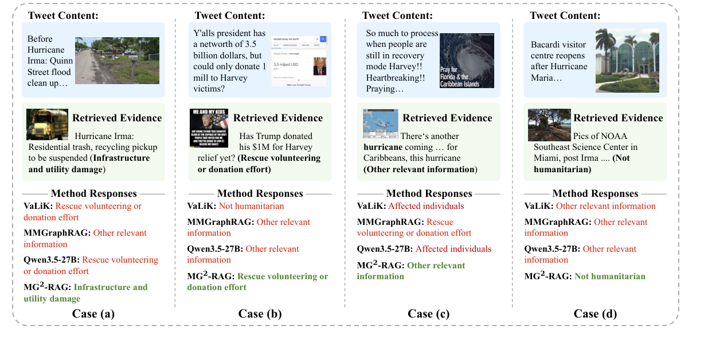

**Figure 7：** 展示灾害清理、救援捐赠、灾害信息更新和建筑重新开放场景；参考帖子与图片共同提供类别判断依据。（第 31—33 页）

### 检索偏差与适用边界

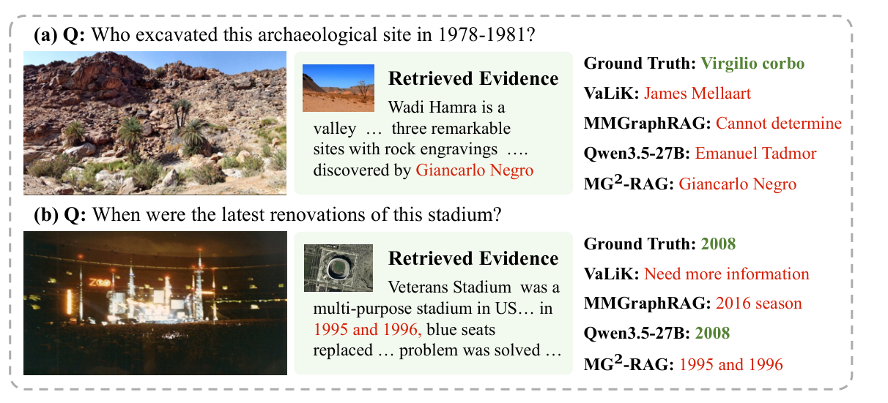

论文的 Figure 8 分析两个代表性偏差：考古遗址问题的正确实体为 **Virgilio Corbo**，系统输出了 **Giancarlo Negro**；体育场装修时间的标准答案为 **2008**，系统依据召回片段输出了 **1995 和 1996**。两例均涉及图片中目标的指代定位，提示**视觉区域定位及实体消歧**仍是系统质量的重要影响因素。（第 33—34 页）

