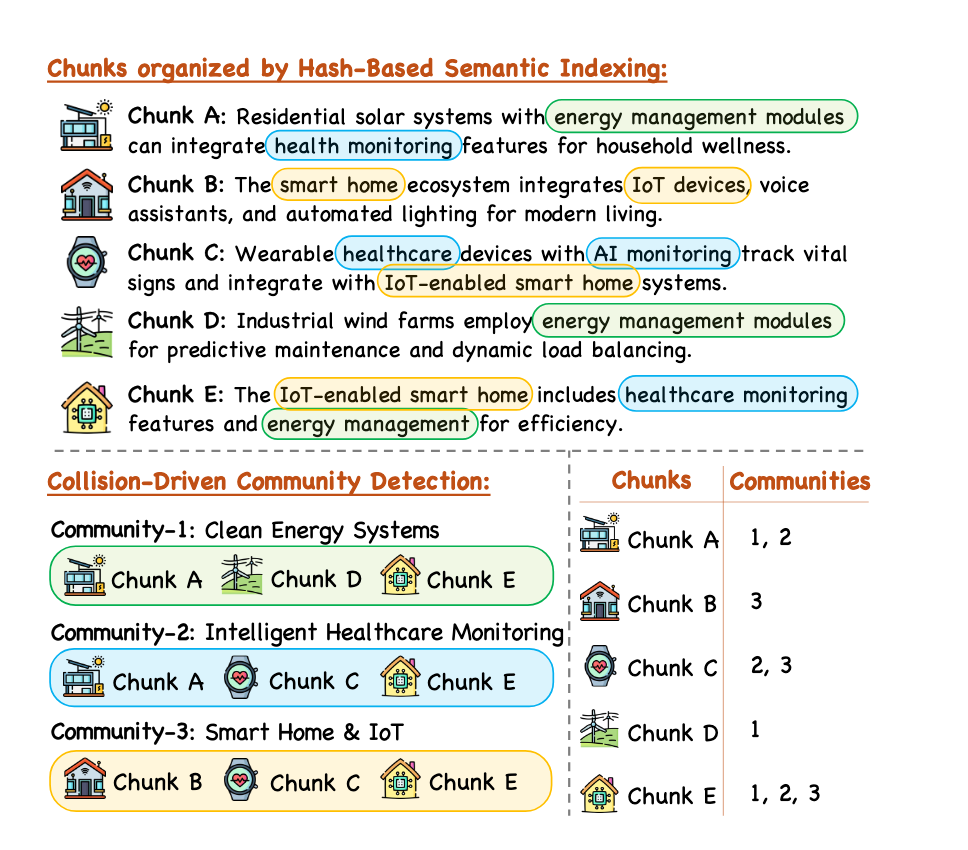
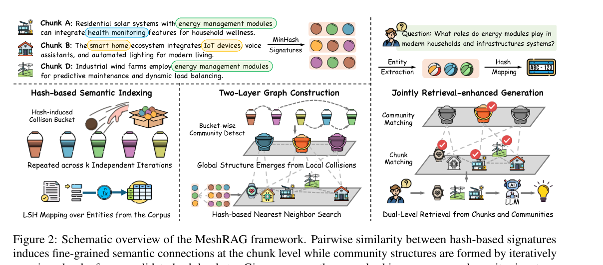
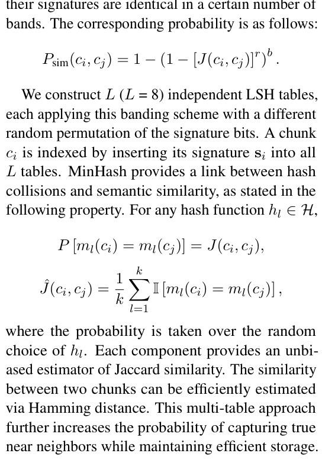
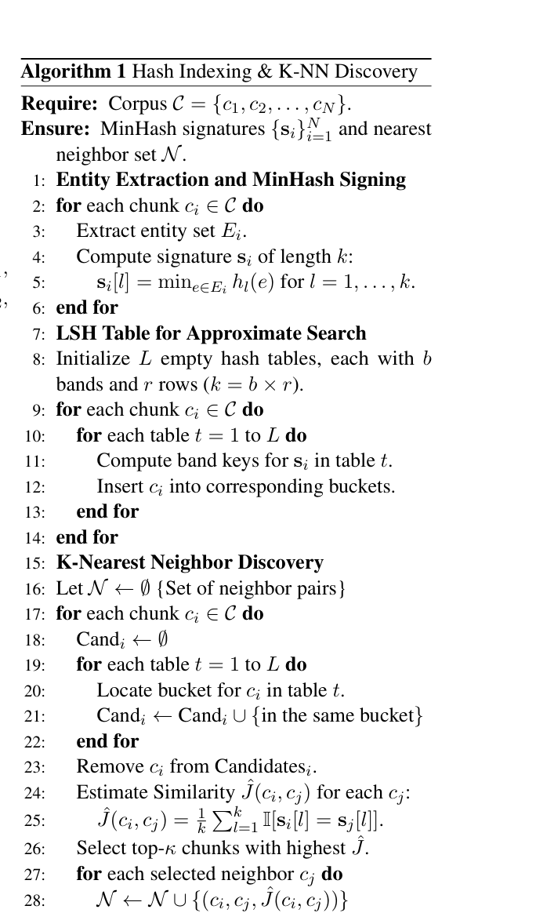
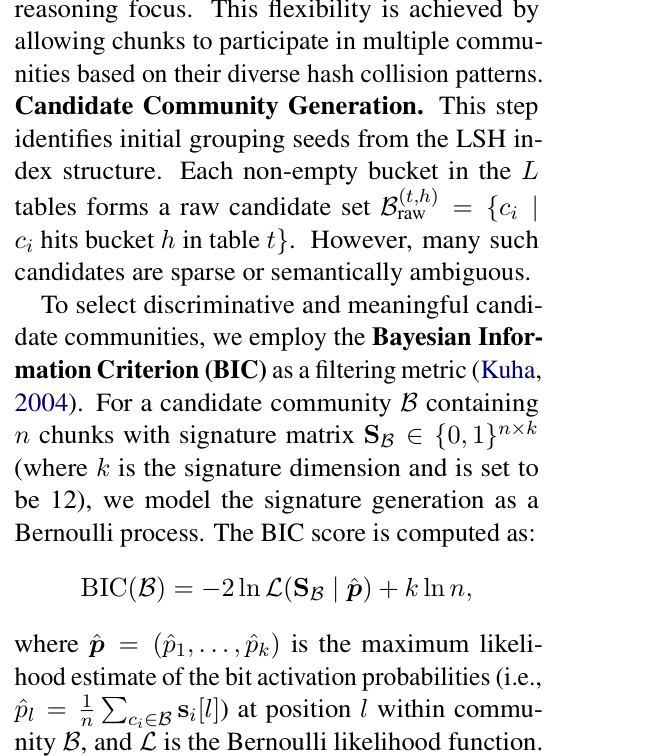
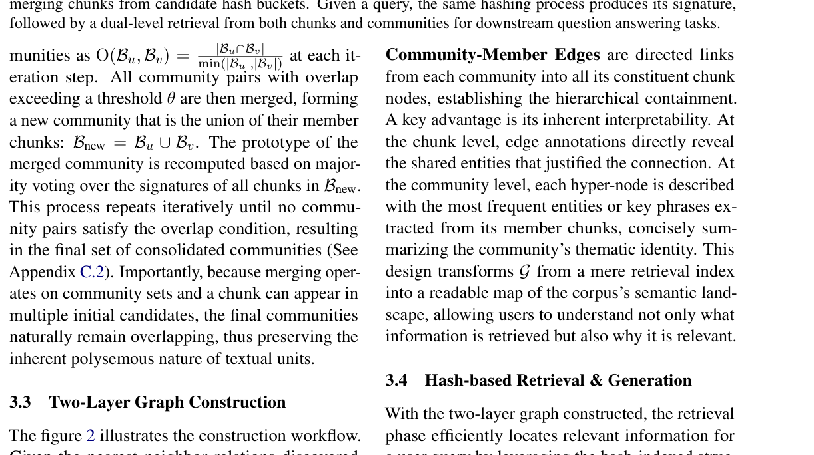
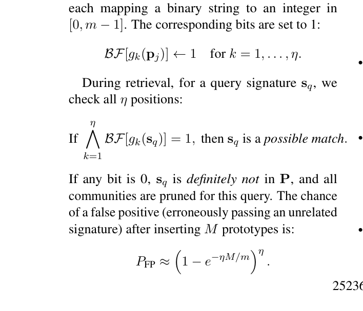

# MeshRAG

## 1. 概要

### 1.1 总体流程

MeshRAG 先从每个文本块中提取实体，再用 **MinHash** 为实体集合生成短签名，用 **LSH** 快速找到相似文本块及候选社区；随后通过 **BIC 评分和社区重叠合并**形成多个允许重叠的社区，得到一张 **Chunk 层 + Community 层**的双层图；查询时同时寻找相关 Community 和相关 Chunk，沿图扩展后选取证据交给大模型回答。

可以分成三件事：

1. **找到相似文本块**：两个文本块如果经常提到相同实体，它们可能有信息联系。**MinHash + LSH** 用较小的计算量找到这些联系。
2. **整理相关主题**：多个相似 **Chunk** 会聚集成候选社区；通过 **BIC** 选择候选，再通过成员重叠合并，形成更稳定的主题社区。
3. **用图辅助找证据**：查询首先定位合适的社区，同时寻找全局相关 **Chunk**，再沿 Chunk 的图边补充相关上下文。

### 1.2 MeshRAG与普通实体图进行比较

传统知识图谱：

```text
实体：张三 ──就读于──→ 实体：武汉理工大学
实体：武汉理工大学 ──位于──→ 实体：武汉
```

MeshRAG 的主结构：

```text
Community 1：清洁能源
  ├── Chunk A：家庭太阳能、能源管理、健康监测
  ├── Chunk D：风电场、能源管理、负载均衡
  └── Chunk E：智能家居、健康监测、能源管理

Community 2：智能健康监测
  ├── Chunk A
  ├── Chunk C：可穿戴设备、健康监测、IoT
  └── Chunk E

Chunk A ──共享实体── Chunk E
Chunk C ──共享实体── Chunk E
```



- **Chunk 节点**代表原文
- **Chunk-Chunk 边**表示两个 Chunk 的相关性，边的证据来自共享实体
- **Community 节点**负责表示一组相关 Chunk 的共同主题
- **Community-Member 边**负责表示“这个 Chunk 属于哪个社区”
- 一个 Chunk 可同时属于多个社区

论文第 2 节定义 Chunk 级属性图：

$$
G=(V,E,\phi)
$$

其中：

- V1V2...VN：Chunk 节点集合，每个 Vi 对应一个文本块 Ci
- E：Chunk 节点之间的无向边。
- 第三个参数：将 Chunk 映射到紧凑哈希签名的映射函数。

第 3.3 节进一步把图组织成 Chunk 和 Community 两类节点。为了便于理解，可整理为：

$$
V_{\mathrm{all}}=V_{\mathrm{chunk}}\cup V_{\mathrm{community}}
$$

$$
E_{\mathrm{all}}=E_{\mathrm{chunk-chunk}}\cup E_{\mathrm{community-member}}
$$

### 1.3 完整流程

 *哈希语义索引 → 双层图构建 → 社区与 Chunk 联合检索 → LLM*



按照数据依赖，可以写成：

```text
建图
原始 Chunk 集合
    ↓
每个 Chunk 提取实体集合
    ↓
每个实体集合计算 MinHash 签名
    ↓
构建 L 张 LSH 哈希表
    ├── 分支 A：同桶候选 → 相似度估计 → Chunk K-NN
    └── 分支 B：桶即候选社区 → BIC 筛选 → 重叠合并
                                    ↓
                            Community Prototype
    ↓
Chunk 节点 + Chunk-Chunk 边 + Community 节点 + 归属边
    ↓
社区原型 Bloom Filter / Chunk LSH 辅助索引

检索
用户问题
    ↓
实体提取 → Query MinHash Signature
    ├── 社区分支：Bloom Filter → Hamming 排序 → Top-m 社区
    └── Chunk 分支：全局 Top-20 锚点 → k-hop 图扩展
    ↓
两路候选取并集
    ↓
重新排序 → 取 Top-5 Chunk
    ↓
GPT-4o-mini 生成答案
```

下面是完整的建图流程以及检索流程：

## 2. 建图一：准备文本 Chunk

论文从已经整理好的文本块集合开始，没有交代具体采用了哪一种分块器、每块多长、重叠

$$
\mathcal C=\{c_1,c_2,\ldots,c_N\}
$$

例如，文档被整理成五个 Chunk：

| Chunk | 内容概括 |
| --- | --- |
| A | 家庭太阳能系统、能源管理模块、健康监测 |
| B | 智能家居、IoT 设备、语音助手、照明 |
| C | 可穿戴健康设备、AI 监测、IoT 智能家居 |
| D | 工业风力发电、能源管理、预测维护 |
| E | IoT 智能家居、健康监测、能源管理 |

**输出：** N 个彼此独立、带原文的文本块。


## 3. 建图二：为每个 Chunk 提取实体集合

对每个 Chunk(ci)，通过**基于正则表达式**的方法提取实体集合：（具体的正则表达式没有给，不知道具体的形式）

$$
E_i=\{e_{i1},e_{i2},\ldots\}
$$

这里的 **Entity** 表示从段落中识别出的名称或实体表达，假设两段文本为：

```text
Chunk A：家庭太阳能系统通过能源管理模块实现优化，还支持健康监测。
Chunk E：智能家居系统集成 IoT、健康监测和能源管理模块。
```

示例：实体提取后得到：

```text
E_A = {太阳能系统, 能源管理模块, 健康监测}
E_E = {智能家居, IoT, 健康监测, 能源管理模块}
```


处理后得到：

$$
\mathcal E=\{E_1,E_2,\ldots,E_N\}
$$


## 4. 建图三：Jaccard 相似度

Chunk 的相关性建立在实体集合的交集与并集上。公式为：

$$
\boxed{J(c_i,c_j)=\frac{|E_i\cap E_j|}{|E_i\cup E_j|}}
$$

- EiEj的交集：两个 Chunk **都包含**的实体。
- EiEj并集：至少出现在一个 Chunk 中的实体。
- 两个实体集合的 Jaccard 相似度范围为 0 到 1。

逐对处理完整实体集合会带来大量重复工作。复杂度非常高，因此论文使用 **MinHash 估算 Jaccard**，随后使用 **LSH 快速获取候选近邻**。MinHash 解决“相似度比较如何变快”，LSH 解决“先比较哪些对象”。


## 5. 建图四：实体集合转换为MinHash 

输入：当前 Chunk 的实体集合 E_i	  
输出：固定长度的 MinHash 签名 s_i

给定 k 个独立哈希函数：

$$
H=\{h_1,h_2,\ldots,h_k\}
$$

这些函数将实体映射到整数。对每个函数 hi，找出它作用在整个实体集合上得到的最小哈希值：

$$
\boxed{m_l(c_i)=\min_{e\in E_i}h_l(e)}
$$

最后，把每次取出的最小值拼成一个向量：

$$
\boxed{s_i=[m_1(c_i),m_2(c_i),\ldots,m_k(c_i)]\in\mathbb Z^k}
$$

第 3.1 节和实验默认：

$$
k=12
$$

因此每个 Chunk 都可以用一组长度为 12 的签名值表示。


**用签名估计相似度：**

论文给出 MinHash 的核心性质：

$$
\boxed{\Pr[m_l(c_i)=m_l(c_j)]=J(c_i,c_j)}
$$

这表示：**对随机选择的 MinHash 函数而言，两个集合最小哈希值相同的概率，等于它们的 Jaccard 相似度。**

将同一个位置的两个签名值进行比较。定义指示函数：

$$
\mathbb I[\text{条件}]=\begin{cases}1,&\text{条件成立}\\0,&\text{条件不成立}\end{cases}
$$

那么：

$$
\boxed{\widehat J(c_i,c_j)=\frac{1}{k}\sum_{l=1}^{k}\mathbb I[m_l(c_i)=m_l(c_j)]}
$$

**签名中相同位置的数量 ÷ 签名总长度**。

当论文默认 k=12 时，同样的方法用于 12 个位置，得到对 Jaccard 的近似估计。

论文附录 A.2 **有关于最小哈希值相同概率 = Jaccard”的证明：**

设两个集合的并集为：

$$
U=E_i\cup E_j
$$

设想把并集里的元素随机排列。某个元素成为排列的第一个元素，每个元素的机会相等。

- 如果这个最先出现的元素同时属于 $E_i$ 和 $E_j$，两个集合得到同一个最小元素。
- 并集共有 $|U|$ 个可选元素。
- 同时属于两个集合的元素共有 $|E_i\cap E_j|$ 个。

因此：

$$
\Pr[m_l(c_i)=m_l(c_j)]
=\frac{|E_i\cap E_j|}{|U|}
=\frac{|E_i\cap E_j|}{|E_i\cup E_j|}
$$

这恰好就是 Jaccard 定义。



**用 Hamming 距离计算minhash的相似度**

将签名视为固定长度的离散序列，可定义 Hamming 距离为不同位置的数量：

$$
d_H(s_i,s_j)=\sum_{l=1}^{k}\mathbb I[s_i[l]\ne s_j[l]]
$$

于是：

$$
\boxed{\widehat J(c_i,c_j)=1-\frac{d_H(s_i,s_j)}{k}}
$$

使用这一性质来衡量 Chunk 签名的接近程度。


## 6. 建图五：MinHash 签名分成 Band

使用hamming距离已经可以对任意两个 Chunk 计算签名相似度。但要从海量 Chunk 中寻找邻居，还需要快速缩小范围。

**LSH Banding** 的思路是：把一条签名切分为几个小组（Band），让相似的签名更容易在至少一个小组中完全匹配，从而进入同一个哈希桶。

论文给出：

$$
\boxed{k=b\times r}
$$

- k：签名长度
- b：Band 数量
- r：每个 Band 的行数

每一个band作为一个键，Band完全相同，则可以成为 LSH 近邻候选。令两段文本的 Jaccard 相似度为 J。在 MinHash 随机性条件下，该位置相等的概率是 J（前面已经证明过）采用标准的独立性近似，一个 Band 的所有 r 个位置都相等的概率是：

$$
J^r
$$

所以一个 Band 没有完全匹配的概率是：

$$
1-J^r
$$

所有 b 个Band 都没有完全匹配的概率是：

$$
(1-J^r)^b
$$

至少有一个 Band 匹配的概率是：

$$
\boxed{P_{\mathrm{sim}}(c_i,c_j)=1-\left(1-[J(c_i,c_j)]^r\right)^b}
$$

这就是论文第 3.1 节给出的 LSH 碰撞概率。在特定 Band 设置下，高相似对象获得更高的碰撞概率，低相似对象的碰撞概率较低。

## 7. 建图六：建立 LSH 哈希表

LSH 表中每个桶存放符合当前 Band Key 的 Chunk 编号。查询某个 Chunk 时，先根据它的签名找到对应的桶，再把同一个桶中的其他 Chunk 作为近邻候选。

第 3.1 节指定：

$$
\boxed{L=8}
$$

系统建立八张独立 LSH 表，每张表用不同的随机置换方式（即重新排列签名位置）处理签名，再应用 Banding。

这样，**同一对相似 Chunk 可以从多个不同置换视角产生碰撞，提高被发现的机会。**

对每个 Chunk c_i：

1. 读取上一步生成的 MinHash 签名 s_i
2. 进入第一张 LSH 表，对签名执行该表的置换与 Banding
3. 根据各 Band 的值计算桶键
4. 将 Chunk 编号写入相应桶
5. 依次处理剩余七张 LSH 表
6. 处理下一个 Chunk，直到整个索引完成

完成后的结构可以表示为多张哈希表：

$$
\mathcal T=\{T_1,T_2,\ldots,T_L\}
$$


***


## 8. 建图七：从 LSH 桶中寻找每个 Chunk 的近邻

系统需要得到这样的连接：

```text
Chunk A
   ├── 邻居：Chunk E，相似度 0.75
   ├── 邻居：Chunk C，相似度 0.67
   └── 邻居：Chunk D，相似度 0.58
```

这批近邻关系后面会变成 **Chunk-Chunk** 图边。论文在附录 Algorithm 1 中给出了这一阶段的详细伪代码。



*附录 Algorithm 1（PDF 第 12 页）。依次执行 Entity Extraction、MinHash Signing、LSH Table、K-Nearest Neighbor Discovery。*

具体步骤：

对于 Chunk c_i，获取它已经生成的 MinHash 签名，根据签名在 8 张 LSH 哈希表中分别计算 Band Key，找到对应的哈希桶，将这些桶中的其他 Chunk 收集起来并去掉自己，形成候选近邻集合；

随后利用各 Chunk 已保存的 MinHash 签名，计算它们与 \(c_i\) 的近似 Jaccard 相似度，按照相似度从高到低排序，选取 Top-\(\kappa\) 个 Chunk 作为 \(c_i\) 的最终近邻，并据此建立 Chunk-Chunk 边。**这里直接使用已有的哈希索引和签名，不需要重新提取实体生成 MinHash。**


***


## 9. 建图八：把 LSH 哈希桶作为原始候选community

前面的 K-NN 关注单个 Chunk 与其他 Chunk 的联系。论文第 3.2 节进一步寻找**多个 Chunk 共同形成的主题community**。

一个 LSH 桶里经常聚集一批签名接近的 Chunk，这个桶可以作为一个社区的初始种子。对第 t 张表里的桶 h，论文定义：

$$
\boxed{B_{\mathrm{raw}}^{(t,h)}=\{c_i\mid c_i\text{ 位于表 }t\text{ 的桶 }h\}}
$$

说明每个非空桶都能形成一个原始候选社区。


***


## 10. 建图九：用 BIC 判断候选社区的内部一致性

论文对一个候选社区中的签名进行统计建模，计算贝叶斯信息准则，

论文第 3.2 节将签名矩阵写为：

$$
S_B\in\{0,1\}^{n\times k}
$$

下面是一个简单的BIC计算示例：

1. 将社区成员的签名排成矩阵

为了演示，讲解示例选择一个社区，含三个 Chunk，每个签名长 3：（这里没有论文解释原始 MinHash 整数签名如何转换成 0/1）

```text
Chunk A：[1,1,0]
Chunk B：[1,1,0]
Chunk C：[1,0,0]
```

得到：

$$
S_B=\begin{bmatrix}1&1&0\\1&1&0\\1&0&0\end{bmatrix}
$$

2.统计每个位置为 1 的比例

论文定义：

$$
\boxed{\widehat p_l=\frac1n\sum_{c_i\in B}s_i[l]}
$$

逐列计算：

- 第 1 列是 1,1,1，因此 =1。
- 第 2 列是 1,1,0，因此 =2/3。
- 第 3 列是 0,0,0，因此 =0。

所以：

$$
\widehat p=\left(1,\frac23,0\right)
$$

第 1 和第 3 个位置对这个社区的成员十分稳定；第 2 个位置存在少量差异。

3.计算 Bernoulli 似然

对每个签名位置，将取值 1 和取值 0 的概率相乘。将论文所述似然展开，可以写成：

$$
\mathcal L(S_B\mid\widehat p)
=\prod_{i=1}^{n}\prod_{l=1}^{k}\widehat p_l^{s_i[l]}(1-\widehat p_l)^{1-s_i[l]}
$$

在讲解示例中：

- 第 1 列全为 1，对似然的贡献为 1
- 第 2 列有两个 1、一个 0，对似然的贡献为(2/3)^2(1/3)。
- 第 3 列全为 0，对似然的贡献为 1。

因此：

$$
\mathcal L=1\times\left(\frac23\right)^2\times\frac13\times1=\frac4{27}
$$

4.计算 BIC：
$$
\mathrm{BIC}(B)=-2\ln\left(\frac4{27}\right)+3\ln3
$$

$$
\mathrm{BIC}(B)\approx3.819+3.296=7.115
$$

这样就给当前候选社区得到一个分数。BIC 越低，越倾向于保留该社区，作者认为这代表更高的内部一致性。（这里也没有给出具体的筛选算法）将保留下来的社区交给下一步进行迭代合并。



*签名矩阵、Bernoulli 参数估计和 BIC 公式。*


***


## 11. 建图十：计算社区重叠度并迭代合并

论文定义：

$$
\boxed{O(B_u,B_v)=\frac{|B_u\cap B_v|}{\min(|B_u|,|B_v|)}}
$$

其中：

- B_u,B_v：两个候选社区。
- |B_u^B_v|：两者共享的 Chunk 数。
- min(|B_u|,|B_v|)：两个社区中较小社区的大小。


论文使用阈值，当：

$$
\boxed{O(B_u,B_v)>\theta}
$$

就把两个社区合成一个新社区：

$$
\boxed{B_{\mathrm{new}}=B_u\cup B_v}
$$

### 

合并一个社区后，这个新社区可能又与其他社区产生足够高的重叠。因此，需要不断重复直到全部社区达到停止条件，

**本步输出：** 最终社区集合：

$$
\mathcal B=\{B_1,B_2,\ldots,B_M\}
$$


***


## 12. 建图十一：生成每个社区的哈希原型

一个 Chunk 有自己的 MinHash Signature；一个 Community 也需要一个可用于检索的代表性签名，这就是 **Community Prototype**。

论文采用对社区成员签名逐位多数投票（Majority Voting）的方式得到原型。

假设某个社区包含三个 Chunk，使用五位二进制签名演示：（这里论文也没有交代签名怎么来的，没有说明用于投票的 0/1 签名究竟如何产生，也没有说明平票处理规则）

```text
Chunk A：[1,0,1,0,1]
Chunk B：[1,1,1,0,0]
Chunk C：[0,0,1,1,1]
```

| 位置 | A | B | C | 出现较多的值 |
| --- | ---: | ---: | ---: | ---: |
| 1 | 1 | 1 | 0 | 1 |
| 2 | 0 | 1 | 0 | 0 |
| 3 | 1 | 1 | 1 | 1 |
| 4 | 0 | 0 | 1 | 0 |
| 5 | 1 | 0 | 1 | 1 |

得出：

$$
p_B=[1,0,1,0,1]
$$


**本步输出：**  \(M\) 个社区的代表性哈希签名：
$$
P=\{p_{B_1},p_{B_2},\ldots,p_{B_M}\}
$$


***


## 13. 建图十二：建立 Chunk-Chunk 无向边

第 8 节得到的 K-NN 结果中包含：

```text
Chunk A → 近邻 Chunk E
Chunk A → 近邻 Chunk C
Chunk B → 近邻 Chunk E
```

论文第 3.3 节把这些近邻关系转换为 **Chunk-Chunk Edges**。由于论文在第 2 节将 Chunk 图边定义为无向边，因此示意为：

```text
Chunk A ───── Chunk E
   │             │
   │             │
Chunk C       Chunk B
```

图边表达的是两个 Chunk 的相关性。论文给出的边标注公式是：

$$
\boxed{\mathrm{entities}(v_i,v_j)=E_i\cap E_j}
$$

即把两个 Chunk 共同包含的实体作为边的解释依据。

例如：

```text
Chunk A：太阳能系统、能源管理、健康监测
Chunk E：智能家居、能源管理、IoT、健康监测
```

那么：

$$
E_A\cap E_E=\{\text{能源管理},\text{健康监测}\}
$$

可以解释为：

```text
Chunk A ────────── Chunk E
 共享实体：能源管理、健康监测
```

**本步输出：** 由近邻关系形成的 Chunk 层图 


***


## 14. 建图十三：建立 Community 节点与跨层归属边

对于每个最终社区 B_j，创建 Community Hyper-Node。该节点的内容主要包括：

- 该社区所包含的 Chunk 编号。
- 社区的 Prototype （也就是哈希签名）。
- 成员文本中出现频率较高的实体或关键短语。

对社区内的每个成员 Chunk，建立从 Community 指向 Chunk 的边（即 Community-Member Edges）：

$$
\boxed{B_j\longrightarrow c_i\quad\text{当 }c_i\in B_j}
$$

最终包含：

| 图对象 | 数量或来源 | 表示的信息 |
| --- | --- | --- |
| Chunk Nodes | N 个，每个 Chunk 一个 | 原始文本知识单元 |
| Chunk-Chunk Edges | 来自 Chunk K-NN | 局部相关性及共享实体 |
| Community Hyper-Nodes | M 个，每个最终社区一个 | 较大范围的主题集合 |
| Community-Member Edges | 每个社区与全部成员相连 | 社区成员归属 |



*社区重叠合并、Prototype 更新、Chunk-Chunk 与 Community-Member 两类边。*


***

## 15. 建图十四：用 Community Prototype 构建 Bloom Filter

假设双层图已经拥有 M 个 Community Prototype。论文进一步将这些原型插入 Bloom Filter（布隆过滤器），作为社区检索的辅助索引。

> 这里简单介绍一下布隆过滤器：一种利用位数组和多个哈希函数快速判断元素是否可能属于某个集合的数据结构，在这里用于初步筛选查询签名与社区的匹配可能性，减少后续需要比较的社区数量。

设社区原型集合为：

$$
P=\{p_1,p_2,\ldots,p_M\}
$$

设 Bloom Filter 的位数组长度为 ，采用 eta 个哈希函数：

$$
g_1,g_2,\ldots,g_{\eta}
$$

论文中指定：

$$
\boxed{\eta=4}
$$

对每个社区原型 p_j：

1. 对 p_j 运行四个哈希函数，生成四个整数位置。
2. 在 Bloom Filter 的位数组中找到这些位置。
3. 将对应位置设置为 1。
4. 处理下一个社区原型，直到所有原型都已加入。

论文附录 A.4 的写法为：

$$
\boxed{BF[g_l(p_j)]\leftarrow1,\qquad l=1,\ldots,\eta}
$$


**本步输出：** Community Prototype Bloom Filter，建图完成。


***


# 查询

## 16. 检索一：问题提取实体、生成 MinHash

假设用户问：

> 能源管理模块在现代家庭与工业基础设施中分别承担哪些作用？

第 3.4 节要求对查询应用与语料相同的实体提取与哈希编码流程。

首先整理查询实体：

$$
E_q=\{e_{q1},e_{q2},\ldots\}
$$

使用与建图时相同的哈希函数：
$$
\boxed{s_q[l]=\min_{e\in E_q}h_l(e)}
$$

于是得到固定长度 Query Signature：

$$
s_q=[s_q[1],s_q[2],\ldots,s_q[k]]
$$

这个查询签名既可以与 Community Prototype 比较，也可以与 Chunk Signature 比较。

**本步输出：** 查询的实体集合 E_q 与哈希签名 s_q。


***


## 17. 检索二：对社区原型进行 Bloom Filter 检查

1. 将 Query Signature 输入四个 Bloom 哈希函数（前面提到过，论文设置的哈希函数为4个）。
2. 得到四个位数组下标。
3. 访问位数组中对应的四个位置。
4. 根据这些位置的值判断签名成员关系。

论文中的成员测试为：

$$
\boxed{\bigwedge_{l=1}^{\eta}BF[g_l(s_q)]=1}
$$

含义：四个位置全部为 1 时，查询签名**可能**存在于已登记的社区原型集合中。**（由于布隆过滤器的性质，全部为1也不一定相同，但只要有一个不为1则一定不相同）**

论文附录 A.4 给出假阳性概率计算方式：

$$
\boxed{P_{\mathrm{FP}}\approx\left(1-e^{-\eta M/m_{\mathrm{BF}}}\right)^{\eta}}
$$

- M：插入的 Community Prototype 个数。
- mBF：Bloom Filter 位数组的长度。
- eta：Bloom 哈希函数个数，论文取 4。

>  在原型个数固定时，**增加位数组长度通常可以减小假阳性概率**。论文说明通过调整位数组长度及哈希函数数量，使假阳性率通常低于 1%。




*Bloom 位设置、查询测试及假阳性概率公式。*

**本步输出：** 四个位置全部为1的候选社区集合。


***


## 18. 检索三：通过 Hamming Similarity 选出相关社区

查询通常可能与几个不同主题的社区有关。例如，能源管理问题同时涉及“清洁能源”和“智能家居”。系统需要找出与查询最匹配的一些社区，然后获取这些社区下的 Chunk。

论文将候选社区记为：

$$
\mathcal C_{\mathrm{candidate}}
$$

对每个候选社区的签名，与查询签名 s_q 进行 Hamming 匹配。

**Hamming Similarity 的计算方式**：

把签名看作定长二进制向量，逐位比较两个签名。一个自然的归一化形式为：

$$
\operatorname{Sim}_H(s_q,p_{C_j})=\frac1k\sum_{l=1}^{k}\mathbb I[s_q[l]=p_{C_j}[l]]
$$

也可写为：

$$
\operatorname{Sim}_H(s_q,p_{C_j})=1-\frac{d_H(s_q,p_{C_j})}{k}
$$


**计算选出前 m 个社区**，论文定义：
$$
\boxed{\mathcal C_{\mathrm{relevant}}=\operatorname{Top}_{m}(\mathcal C_{\mathrm{candidate}},\operatorname{Sim}_H)}
$$

默认推荐：

$$
\boxed{m=5}
$$

**本步输出：** 更准确的候选社区 及这些社区包含的全部 Chunk。


***


## 19. 检索四：全局寻找 Top-20 Chunk 作为 Anchor Nodes

只得到候选社区还不够精确，社区检索关注较大的主题范围。实际问题中，还可能存在一段很有用的原文，与查询高度相关，却分布在另外的社区或社区边缘。论文因此增加一个检索分支：直接使用 Query Signature，从全局 Chunk 索引中寻找相关文本块。

具体的处理过程：

1. 生成 Query 的 MinHash 签名：提取用户问题中的实体集合 \(E_q\)，使用建图时相同的 12 个哈希函数，分别取最小哈希值，得到查询签名；

2. 利用 LSH 定位候选 Chunk：将查询签名映射到建图时创建的 8 张 LSH 哈希表中，按照各表的随机置换和 Banding 规则计算 Band Key，找到对应的哈希桶，收集桶内所有 Chunk。
3. 合并候选并计算相似度：将各哈希桶中的 Chunk 合并（取并集）去重，得到候选集合 \(\mathrm{Cand}_q\)，再将查询签名与各候选 Chunk 已保存的 MinHash 签名逐位置比较，计算近似 Jaccard 相似度

4. 排序并选取 Top-20：按照近似 Jaccard 相似度从高到低排序，选出最相关的 20 个 Chunk，作为后续 k-hop 图扩展的锚点（Anchor Nodes）。

根据论文描述，可整理为：

$$
\boxed{A_q=\operatorname{Top}_{20}\{c_i,\widehat J(q,c_i)\}}
$$


**本步输出：** 包含 20 个 Chunk 的锚点集合 Aq。


***


## 20. 检索五：从 Anchor Nodes 沿 Chunk 图执行 k-hop 扩展

**对每个 Anchor ：**

1. 读取当前锚点 Chunk。
2. 根据 Chunk-Chunk Edges 找到直接连接的邻居。
3. 当配置为 1-hop 时，收集锚点及其直接邻居。
4. 当配置为 2-hop 时，再从第一层邻居继续访问下一层邻居。
5. 对 20 个锚点的扩展结果取并集，合并重复 Chunk。

论文中推荐选 1-hop，第 4.5 节的消融实验显示，扩展跳数增加时，候选覆盖范围也会显著增大。

- 1-Hop + 5 Communities：搜索比例 15.3%，准确率 37.0%。
- 2-Hop + 5 Communities：搜索比例 43.9%，准确率 37.2%。

两跳多检查了相当多的候选，准确率只提高 0.2 个百分点。因此作者最终推荐**一跳扩展和五社区组合，兼顾准确率与检索成本。**

**本步输出：** 基于全局锚点的 Chunk 邻域集合 $\mathcal N_h(A_q)$。


***


## 21. 检索六：把两路结果合并为候选池

论文**使用两路结果的并集**形成最终候选池 Pq。

$$
\boxed{P_q=\left(\bigcup_{C_j\in\mathcal C_{\mathrm{relevant}}}\mathrm{Members}(C_j)\right)\cup\mathcal N_h(A_q)}
$$

其中：

- MembersC_j：相关社区内所有成员 Chunk。
- Nh(Aq)：20 个锚点的图扩展结果。
- Pq：两路候选合并后的 Chunk 集合。

**本步输出：** 等待最终重新排序的候选集合 Pq。


***


## 22. 检索七：对候选池重排，保留最后五个 Chunk

论文第 3.4 节给出最终检索数量：

$$
\boxed{K_{\mathrm{final}}=5}
$$

可以用通用的重排符号表示：

$$
R_q=\operatorname{Top}_5(P_q,\operatorname{Score}(q,c))
$$

Score表示重排所用的评分方法。


***


## 23. 检索八：把五个 Chunk 交给 LLM 生成答案

### 23.1 生成模型得到什么输入

答案生成阶段包含：

1. 用户提出的问题 $q$。
2. 最终检索到的五个 Chunk 原文。
3. 问答提示语或上下文模板。

可以概括为：

$$
\boxed{\mathrm{Answer}=\mathrm{LLM}(q,R_q)}
$$

**论文实验的完整检索流程：**

```text
用户问题
    ↓
实体提取 + Query Signature
    ├────────────────────────────┐
    ↓                            ↓
Community Prototype           Chunk LSH Index
Bloom 检查                       ↓
    ↓                        全局 Top-20 Anchors
Hamming 排序                     ↓
    ↓                        1-Hop 图扩展
Top-5 Communities                │
    ↓                            │
获取社区成员 Chunk                 │
    └──────────────┬─────────────┘
                   ↓
                集合并集
                   ↓
                候选重排
                   ↓
             最终 Top-5 Chunk
                   ↓
               GPT-4o-mini
                   ↓
                问题答案
```


