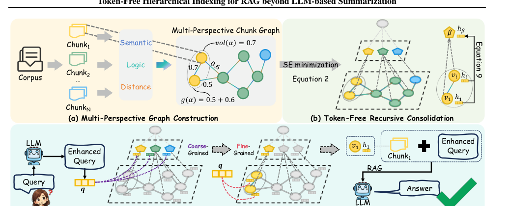
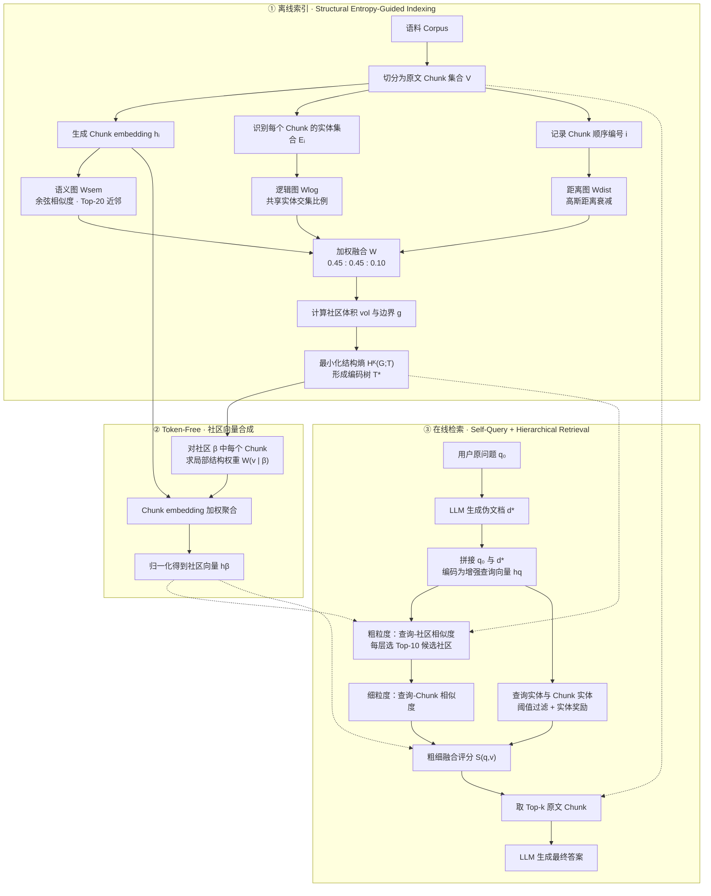
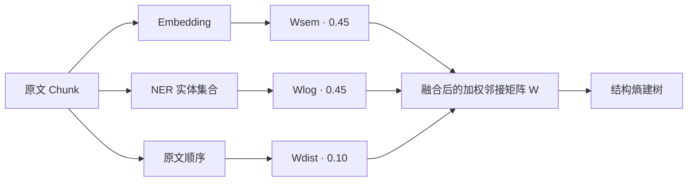
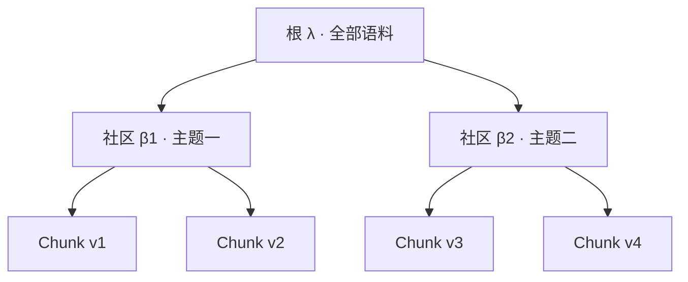
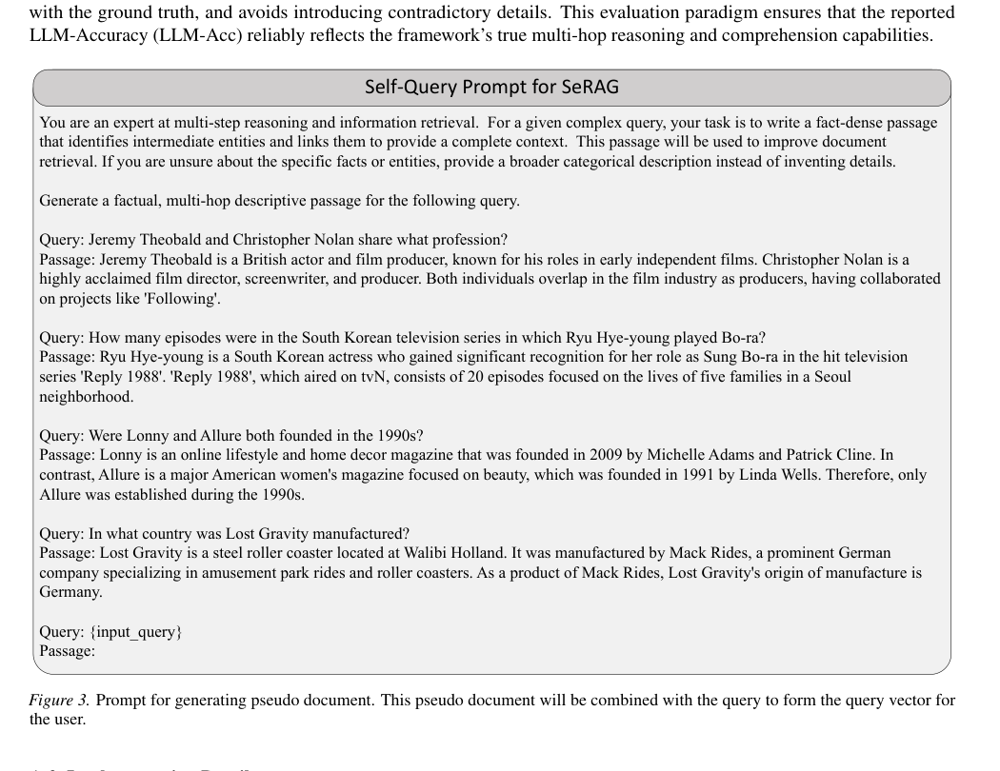
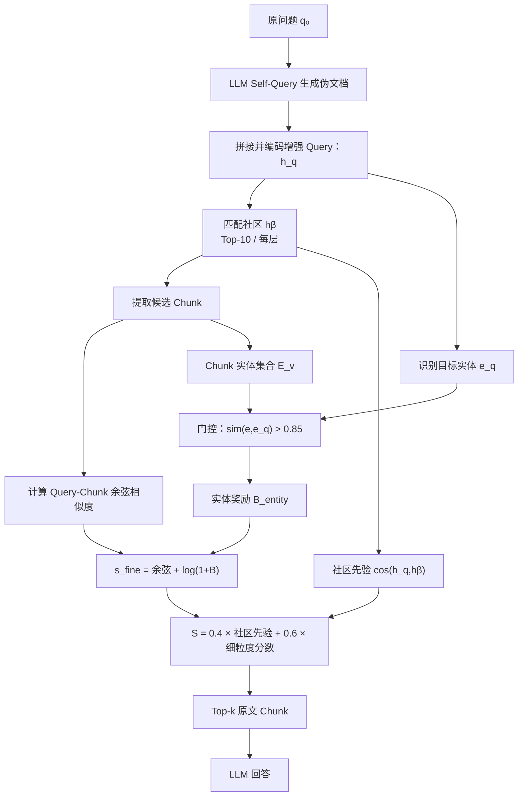

# SeRAG：Token-Free Hierarchical Indexing for RAG beyond LLM-based Summarization

---

## 总体流程

SeRAG 的核心思想是：**先把文本块构造成融合语义、实体交集与文本相邻关系的加权图，再通过最小化结构熵构建层次化社区树，利用结构权重对文本向量进行聚合而不是让 LLM 写社区摘要，最后通过问题扩写和“社区粗筛 + Chunk 细排”返回原文证据。** [PDF pp.1–5]

可以归纳为三件事：

1. **多视角建图 + 结构熵分层**：每个原始 Chunk 是图节点，边综合 `Semantic / Logical / Distance` 三个信号，编码树的叶节点对应 Chunk，内部节点对应社区。[§2.1–3.1]
2. **Token-Free 向量聚合**：在树中对每个社区计算原文 Chunk 的**局部结构熵贡献权重**，对 Chunk embedding 做加权平均并归一化，形成社区 embedding；不请求 LLM 为社区生成摘要。[§3.2]
3. **查询增强 + 层次检索**：可调用一次 LLM 生成伪文档，以“原问题 + 伪文档”形成增强 Query；根据社区相关度、Chunk 语义相关度、实体奖励组合评分，检索 Top-k 原文并用于回答。[§3.3、Appendix A.1]

**特别注意**：`Token-Free` 指**索引阶段的社区抽象不使用 LLM 生成摘要 Token**，不是整个 SeRAG 从不使用 LLM；在线 Self-Query 扩写、最终答案生成、以及实验的 LLM 评测仍可使用 LLM。[PDF pp.2,4,7,12]

### 图 1：论文整体架构



**原图的三个子图：**

- **Figure 1(a)**：Corpus → 多个 Chunk → 语义/逻辑/距离三种视角 → 加权 Chunk 图。
- **Figure 1(b)**：对图进行结构熵最小化 → 生成编码树 → 根据原始 Chunk 向量和结构权重构建社区向量。
- **Figure 1(c)**：原问题经 LLM 自查询增强 → 在编码树上进行粗到细检索 → 原文 Chunk 与问题进入 LLM → 答案。

### 完整流程



**重要边界**：流程图中的 Top-20、0.45/0.45/0.10、Top-10、Top-k 来自附录实验配置；“粗筛后细排”的整体逻辑来自正文。**论文没有完整给出结构熵树构造的逐步算法和所有程序级的候选合并操作，不能把本图视作作者原始伪代码。**

---

# 一、问题定义与核心概念

## 1. 研究目标：为什么需要 SeRAG？

**输入**：一组可供检索的原始文本块（Chunks）；**目标**：以较低索引构建成本得到兼顾整体主题与局部事实的检索结构，服务复杂多跳问答。[§1–2]

传统方案的主要不足：

1. **Vanilla RAG** 直接做 Chunk embedding 检索，对多个分散但相关的事实不容易建立全局关联。
2. **基于实体—关系—实体三元组的 GraphRAG** 常需 LLM 抽取细粒度实体和关系，带来索引 Token 成本、时间开销以及抽取误差。
3. **RAPTOR、Microsoft GraphRAG 等层次方法** 常采用启发式聚类与 LLM 递归摘要；每个社区生成文本摘要既消耗 Token，又可能压缩掉细节信息。

**SeRAG 解决的具体问题**是：能否用**图结构 + 信息论优化 + 向量聚合**代替“LLM 为每层写摘要”的索引方案，同时保持社区级主题信息与 Chunk 级细节。[PDF pp.1–2]

## 2. 基本符号与数据对象

设语料被组织为 $n$ 个信息单元：

$$
V=\{v_1,v_2,\ldots,v_n\},\qquad G=(V,E,W).
$$

| 符号 | 含义 | 在流程中承担的作用 |
|---|---|---|
| $v_i$ | 第 $i$ 个基础信息单元，通常为原始 Chunk | 最小证据与图节点 |
| $h_i$ / $h_v$ | Chunk 的稠密语义向量 | 语义建边、社区聚合与细粒度匹配 |
| $\mathcal E_i$ | Chunk $i$ 识别出的命名实体集合 | 计算逻辑层关联 |
| $W^{sem},W^{log},W^{dist}$ | 三种视角的邻接/权重矩阵 | 构造图 |
| $W$ | 融合后的加权邻接矩阵 | 结构熵的数值输入 |
| $T$、$T^*$ | 候选编码树、最优编码树 | 层次化社区索引 |
| $\lambda$ | 编码树的根节点 | 表示整个信息空间 |
| $\alpha,\beta$ | 编码树中的社区/节点 | 定义层次与社区归属 |
| $V_\alpha$ | 社区 $\alpha$ 包含的叶子 Chunk 集合 | 计算体积、割边与社区向量 |
| $\alpha^-$ | 树节点 $\alpha$ 的父节点 | 结构熵项的归一化参照 |
| $g(\alpha)$ | 社区与外部之间的边权之和 | 衡量社区边界连接 |
| $\operatorname{vol}(\alpha)$ | 社区内全部节点的加权度之和 | 衡量社区体积 |
| $K$ | 结构熵的维度/树层次约束 | 实验设置 $K=2$ |
| $W(v\mid\beta)$ | Chunk 在目标社区内的局部结构权重 | 决定聚合的贡献大小 |
| $h_\beta$ | 社区的聚合表示向量 | 粗粒度主题匹配 |
| $q_0$、$q$、$h_q$ | 原问题、增强问题、增强问题向量 | 在线检索锚点 |
| $\gamma_c,\gamma_f$ | 社区和 Chunk 评分权重 | 平衡全局主题与局部事实 |
| $\tau$ | 实体语义过滤阈值 | 过滤低可信实体匹配 |

> **概念上要分清**：图 $G$ 的节点都是 **Chunk**；编码树 $T^*$ 的叶子对应这些 Chunk、内部节点表示 Chunk 社区；被抽取的 **Entity 是逻辑层建边的依据**，并没有被定义为 $G$ 中的另一种节点类型。[§2.1、§3.1]

---

# 二、离线索引第一阶段：多视角 Chunk 图构建

## 1. 建图一：从 Corpus 获得 Chunk 集合

**输入**：原始语料 Corpus。**处理**：预先组织为 $V=\{v_1,\ldots,v_n\}$。每个 $v_i$ 对应保留原文内容的检索单元；给每个 Chunk 关联顺序索引 $i$、来源与原文，便于后续记录邻近关系和返回证据。[§2.1、§3.1]

**【待核实】论文以已经划分的 Chunk 为输入，没有明确规定唯一的分块策略、chunk_size、overlap、跨文档编号重置规则。** 若用既有 RAG 框架实现，不能把某种分块参数误认为论文给出。

**输出**：Chunk 文本、索引编号、向量输入，以及实体识别的输入。

## 2. 建图二：语义层（Semantic Layer）

先用 embedding 模型将每个 Chunk 映射为 $h_i$，再以余弦相似度衡量两个 Chunk 在语义上的接近程度。[Eq.(3)，PDF p.3]

$$
\boxed{w_{ij}^{sem}=\cos(h_i,h_j)} \tag{3}
$$

- **作用**：连接措辞不同、但表达相近主题的 Chunk。
- **原因**：只比较是否出现相同实体会漏掉隐含的语义联系。
- **稀疏化**：附录明确使用 KNN 过滤，每个信息单元仅连接语义最相近的 **$k_{sem}=20$ 个邻居**。[Appendix A.3, PDF p.13]

**【待核实】** 原文没有详细规定余弦相似度的负数如何处理、KNN 的方向边如何对称化，以及不同图层融合前是否另行裁剪/归一化。由于论文把 $G$ 定义为**加权无向图**，工程复现必须明确这些规则；切勿擅自当成原文细节。

**输出**：$W^{sem}$。

## 3. 建图三：逻辑层（Logical Layer）

对每个 Chunk 识别命名实体集合 $\mathcal E_i$，根据两个 Chunk 的**共享实体数**计算边权。[Eq.(4)，PDF p.3]

$$
\boxed{w_{ij}^{log}=\frac{|\mathcal E_i\cap\mathcal E_j|}{\max(|\mathcal E_i|,|\mathcal E_j|)}} \tag{4}
$$

**四步理解**：

1. 对 Chunk $i$ 与 $j$ 提取实体集合 $\mathcal E_i,\mathcal E_j$。
2. 求交集，统计共享实体数量。
3. 取两者实体集合大小的较大值作归一化分母。
4. 有公共实体时赋予正的逻辑关联；交集为 0 时分子为 0。

**演示例子（本文自拟，非论文实验数据）**：

```text
Chunk A：{Beatrice I, Frederick Barbarossa}
Chunk B：{Frederick Barbarossa, Germany, Holy Roman Empire}
交集：{Frederick Barbarossa}
逻辑边权：1 / max(2,3) = 1/3
```

**关键区别**：这里是**“实体集合交集”**，不是抽取带谓词的三元组。两个 Chunk 共享同一个人物/地点等事实锚点，即使整体语义不相近，也可能在图中建立联系。**公式采用 `max`，不是 Jaccard 的并集，也不是 `min`。**

**【待核实】** 论文没有给出 NER 模型、实体去重/同义消歧流程、实体类型筛选策略，也未定义两个实体集合都为空时的分母为 0 应如何处理；需由具体实现决定。

**输出**：$W^{log}$。

## 4. 建图四：距离层（Distance Layer）

将文本块的**序列位置**编码成邻近关系，使源文档中相邻的内容有一定机会被组织到同一社区。[Eq.(5)，PDF p.3]

$$
\boxed{w_{ij}^{dist}=\exp\!\left(-\frac{(i-j)^2}{2\sigma^2}\right)} \tag{5}
$$

- $i,j$：Chunk 在源文档中的顺序编号。
- $\sigma$：衰减范围参数。实验采用 $\sigma_{dist}=5$。[Appendix A.3]
- $|i-j|$ 越小，边权越大；距离越远，边权按高斯函数下降。
- 附录描述距离边用于聚焦**相邻 10 个单元左右的局部上下文窗口**。[PDF p.13]

**解释示例**：取 $\sigma=5$，当两个 Chunk 的下标相差 $1$ 时，距离边权约 $0.9802$；相差 $5$ 时约 $0.6065$；相差 $10$ 时约 $0.1353$。这些是依公式的计算示例，并非论文测量值。

**【待核实】** 文字写明保留文档局部叙述连续性，但没有完整规定跨文档编号的距离是否要清零，以及“window of 10”是以每个节点前后各 10 为界还是总窗口为 10，不能在笔记中替作者选定。

**输出**：$W^{dist}$。

## 5. 建图五：三层邻接矩阵融合

三种视角线性加权得到统一图。[Eq.(6)，PDF p.3]

$$
\boxed{W=\lambda_1W^{sem}+\lambda_2W^{log}+(1-\lambda_1-\lambda_2)W^{dist}}\tag{6}
$$

实验中的具体权重是：

$$
\boxed{W=0.45W^{sem}+0.45W^{log}+0.10W^{dist}.}
$$

| 层 | 权重 | 保留的信息 | 典型作用 |
|---|---:|---|---|
| Semantic | 0.45 | 隐含语义邻近 | 同主题不同措辞互联 |
| Logical | 0.45 | 命名实体共享 | 连接分散的多跳事实 |
| Distance | 0.10 | 文档顺序接近 | 尽量保持局部上下文连续性 |

**本步输出**：加权图 $G=(V,E,W)$。接下来建树**不是**再次按 Chunk 向量单独做普通 K-means，而是把已经融合三层关系的 $W$ 送入结构熵优化。[§3.1–3.2]



---

# 三、离线索引第二阶段：结构熵引导的层次编码树

## 1. 树的节点究竟代表什么？

**【原文】** 给定加权无向图 $G$，构造编码树 $T$：[§2.2, PDF p.2]

- **根节点 $\lambda$**：代表整个语料的信息空间。
- **内部节点 $\alpha,\beta$**：代表一个社区，即 Chunk 子集 $V_\alpha\subseteq V$。
- **叶节点**：与每一个原始 Chunk $v_i$ 一一对应。
- **父子关系**：代表主题/知识群组由粗到细的包含关系。



上图只是为了帮助理解的**自拟示意**，不是论文指定有 4 个 Chunk 或始终只有两个社区。

## 2. 结构熵需要两个基础量：体积与边界割边

原文根据邻接矩阵 $W$ 定义：[Eq.(7)，PDF p.3]

$$
\boxed{\operatorname{vol}(\alpha)=\sum_{v\in V_\alpha}\sum_{u\in V}W_{vu}}
$$

$$
\boxed{g(\alpha)=\sum_{v\in V_\alpha}\sum_{u\notin V_\alpha}W_{vu}}\tag{7}
$$

含义：

1. **$\operatorname{vol}(\alpha)$** 是社区 $\alpha$ 内所有节点与**全图各点**连接权重的总和，即社区内节点的加权度总和；**不是**仅将社区内部边相加。
2. **$g(\alpha)$** 是从社区内部指向社区外部的边权之和，即**边界割边权重**。
3. 如果一个社区内部联系强、对外连接少，通常更符合“聚在一起”的直观要求。

**示例**：社区 $\alpha=\{A,B\}$，其中 $A$ 和 $B$ 的内部边权为 $0.7$，从 $A$ 到外部的边权为 $0.5$、从 $B$ 到外部为 $0.6$，且无其他边。则 $g(\alpha)=0.5+0.6=1.1$，$\operatorname{vol}(\alpha)=2\times0.7+0.5+0.6=2.5$。这是辅助计算示例；论文 Figure 1(a) 用颜色标记了 $\operatorname{vol}$ 和 $g$ 的概念，但不应把本例数字误认为图中全部实际数据。

## 3. $K$ 维结构熵与最优编码树

对树中每个非根节点 $\alpha$，计算边界占全图体积比例，乘上其相对于父节点的体积变化的信息量，再求和：[Eq.(1)，PDF p.2]

$$
\boxed{H^{K}(G;T)=-\sum_{\alpha\in T,\,\alpha\ne\lambda}
\frac{g(\alpha)}{\operatorname{vol}(G)}
\log_2\frac{\operatorname{vol}(\alpha)}{\operatorname{vol}(\alpha^-)}}
\tag{1}
$$

优化目标：[Eq.(2)]

$$
\boxed{T^*=\arg\min_T H^K(G;T)}\tag{2}
$$

解释：

1. **遍历候选树结构**：每种树的社区划分不一样，$\operatorname{vol}$ 与 $g$ 所对应的熵贡献也不同。
2. **计算结构熵**：按照公式 (1) 汇总每个非根树节点的贡献。
3. **寻找更低熵的层次划分**：选择（或者以算法近似求取）目标函数更小的树，作为最终层次索引。
4. **结果不是“树的文本摘要”**：结构熵这一步只决定**谁与谁被组织在同一层级社区**。

为什么强调结构熵？相比简单地“两个向量相似就聚在一起”，该目标使用**整个融合加权图的结构信息**指导分层，可以兼顾跨 Chunk 的逻辑锚点与主题连贯性。[§2.2、§3.1]

**【待核实】结构熵优化的关键缺口：** 本论文在正文和附录给出了数学目标及 $K=2$，却没有完整写出**实际求解 $T^*$ 的算法步骤**（初始树、节点合并/拆分策略、优化顺序、停止准则、时间复杂度），不能把“$\arg\min$”自动理解为暴力穷举或者已经给出了可直接实现的贪心伪代码。复现时应以作者代码或额外公开说明为准。

## 4. $K=2$ 到底是什么意思？

附录 Table 5 明确：**`K-dimensional Entropy Partitioning (K) = 2`**，正文称 **2-dimensional encoding tree**。[PDF pp.13–14]

- 它是结构熵层次约束的参数，**不是**指“每个社区只有 2 个子节点”、也**不是**“每个 Chunk 只能连接 2 条边”。
- 从编码树角度理解，$K=2$ 对应二维结构熵所约束的层次表达，实际层级编号、根与叶是否计层，需要结合原算法的实现判定。
- **【待核实】** 论文没有给出所有建树约束及其完整实现，因此不要仅根据 $K=2$ 就擅自推断真实树一定具有多少中间社区或多少层迭代。

**本阶段最终输出**：$T^*$、叶子到社区的映射、社区父子关系，以及后续计算结构权重所需的 $g(\alpha)$、$\operatorname{vol}(\alpha)$。

---

# 四、离线索引第三阶段：Token-Free Recursive Consolidation

## 1. 为什么不为社区生成文本摘要？

传统层次 RAG 通常让 LLM 对某社区中的多个 Chunk 生成一段总结，再对摘要继续聚合。SeRAG 用**数值向量**直接形成社区语义表示，避免索引阶段的生成式摘要开销，并避免摘要可能丢失原始细节的风险。[§3.2, PDF p.4]

**注意：没有生成社区文本摘要，并不等于不保留原文；Chunk 仍然是最终证据来源。**

## 2. 聚合一：计算 Chunk 在目标社区中的局部结构权重

对目标社区 $\beta$ 中的一个叶节点 $v$，原文把从该叶节点到 $\beta$ 的**唯一树路径**上中间节点的熵贡献累加，得到：[Eq.(8), PDF p.4]

$$
\boxed{W(v\mid\beta)=S_e(v\mid\beta)=
-\sum_{\alpha\in\operatorname{Path}(v\to\beta)\setminus\{\beta\}}
\frac{g(\alpha)}{\operatorname{vol}(\beta)}
\log_2\frac{\operatorname{vol}(\alpha)}{\operatorname{vol}(\alpha^-)}}
\tag{8}
$$

**公式转写说明**：论文印刷式的求和范围写作 $\beta\subset\alpha\subseteq\gamma$，同时正文说“从叶节点 $\gamma$ 向上到社区 $\beta$，不包含 $\beta$ 自身”；若把 $\subset$ 解释为节点对应**叶集合**的包含关系，这个印刷范围与树的包含方向容易发生歧义。为了避免误导，上式只以 `Path(v→β) \ β` 表达**原文明确的文字含义**；分式、对数及符号保持 Eq.(8) 的数学形式。工程实现应对照源码确认路径约定。

计算逻辑：

1. 找到包含 $v$ 的目标社区 $\beta$。
2. 沿编码树从 $v$ 向上走到 $\beta$，**不计入 $\beta$ 本身**。
3. 对路径上的节点 $\alpha$ 计算由 $g(\alpha)$、$\operatorname{vol}(\alpha)$、父节点体积决定的熵项。
4. 将公式 (1) 的全图归一化分母 $\operatorname{vol}(G)$ 换为**当前社区的** $\operatorname{vol}(\beta)$，并累加。
5. 得到 $W(v\mid\beta)$，用于区分该 Chunk 对指定社区结构的重要性。

**核心理解**：同一个 Chunk 在不同社区层次中，可能有不同的结构权重；这是“**局部权重**”，不是对全图每个 Chunk 只计算一次的固定权重。

## 3. 聚合二：根据局部权重计算社区 embedding

按论文 Eq.(9)：[PDF p.4]

$$
\boxed{h_\beta=\operatorname{Normalize}\!\left(
\frac{\sum_{v\in V_\beta}W(v\mid\beta)\,h_v}
{\sum_{v\in V_\beta}W(v\mid\beta)}\right)}
\tag{9}
$$

1. **输入**：社区 $\beta$ 内每个原始 Chunk 的向量 $h_v$ 与局部权重 $W(v\mid\beta)$。
2. **加权求和**：重要性高的 Chunk 对最终社区向量影响更大。
3. **除以总权重**：形成结构加权均值。
4. **归一化**：得到社区语义向量 $h_\beta$，便于后续计算余弦相似度。
5. **跨层复用**：把该方法应用在编码树各层社区，得到不同尺度的语义表示。

**【待核实】** 正文称 *Recursive Consolidation*，但 Eq.(9) 的明确计算对象是“$V_\beta$ 中的叶节点 Chunk 向量”，**没有唯一规定**“父社区只能拿直接子社区 embedding 再聚合”这一种递归实现。不要把“树上逐层计算社区向量”自动等同于改变了 Eq.(9) 的叶子聚合对象。分母为零时的处理、Normalize 是否严格采用 $L_2$ 归一化也没有在正文详细指定。

### 对比：简单平均、LLM 摘要与 SeRAG 聚合

| 方法 | 社区表示 | 关键代价或问题 |
|---|---|---|
| 普通均值池化 | $\operatorname{mean}(h_v)$ | 所有 Chunk 权重一样，未利用图结构 |
| LLM 社区摘要 | 一段由 LLM 生成的文本，再编码/检索 | 需要生成式 Token，可能丢细节 |
| **SeRAG** | $\operatorname{Normalize}(\sum W(v\mid\beta)h_v/\sum W(v\mid\beta))$ | **索引聚合无需 LLM 生成摘要**，但需要图、结构熵与 embedding 计算 |

**本阶段输出**：每一个需要搜索的社区对应的 $h_\beta$，与树 $T^*$ 一起构成可检索的多粒度索引。

---

# 五、在线检索第一阶段：Self-Query 查询增强

## 1. 检索一：输入原问题

**输入**：用户查询 $q_0$。短问题可能只包含一个实体或一个目标关系，直接用于向量检索时存在“语义过于稀疏”的问题。[§3.3, Appendix A.1]

## 2. 检索二：让 LLM 生成伪文档（Pseudo-Document）

作者采用含少样本示例的提示词，请 LLM 生成描述性、事实密集的短文，**尝试补足中间实体和潜在连接**。提示词特别要求：如果不确定事实，应使用更宽泛的类别描述，**不要捏造具体细节**。[Figure 3, PDF p.12]



原提示词有 **4 个示例**，主题分别是：

1. Jeremy Theobald 与 Christopher Nolan 的共同职业；
2. Ryu Hye-young 扮演 Bo-ra 的剧集有多少集；
3. Lonny 与 Allure 是否都创办于 1990 年代；
4. Lost Gravity 过山车在哪个国家制造。

它们的共同写法是：**把一个直接问法扩展成包含相关人物、作品、时间、企业、地理背景及关系的较长 Passage。** 这些例子构成作者的 few-shot 提示设计，而不是本论文的数据集评价结果。

## 3. 检索三：拼接问题与伪文档并向量化

**【原文】** 附录明确把生成的伪文档与原问题串接，以得到最终查询向量 $h_q$。[Appendix A.1]

可用下式表达这一文本处理顺序（**本式为过程记号，不是论文单独列出的编号公式**）：

$$
 d^*=\operatorname{LLM}(\operatorname{SelfQueryPrompt}(q_0)),\quad
 q=\operatorname{Concat}(q_0,d^*),\quad
 h_q=\operatorname{Embed}(q).
$$

**目的**：把问题中未明示、但可能与答案相关的术语补充到 query embedding 中，以提高它与社区 embedding、Chunk embedding 的可比较性。

**【待核实】** 原文没有明确 `Concat` 的精确分隔符、文本模板、LLM 解码参数与伪文档长度上限。扩写事实仍需由检索原文验证，不能把 LLM 生成的伪文档当作可靠知识来源。

**本阶段输出**：增强后的查询文本 $q$ 与向量 $h_q$。

---

# 六、在线检索第二阶段：粗到细的层次评分

## 1. 检索四：社区粗粒度匹配（Coarse-Grained）

利用上一阶段的 $h_q$ 与各社区的 $h_\beta$ 计算余弦相似度：[Eq.(10)，PDF p.4]

$$
\operatorname{sim}_{coarse}(q,\beta)=\cos(h_q,h_\beta).
$$

含义：优先寻找“整体主题最可能包含答案”的社区，然后再关注其中的细节 Chunk。这一相似度是后面总评分的**结构先验**，不是答案段落的最终分数。

**附录配置**：每个层次保留 **$k_{coarse}=10$ 个最相关候选社区**。论文用的是单次查询增强和单轮融合评分，不要求每跳再调用一次 LLM 做推理。[§3.3、Appendix A.3]

**【待核实】** 原文没有详细规定同层候选之间的相似度聚合、候选社区可能重叠时的去重、以及多层候选命中同一个 Chunk 时如何合并多个 $\beta$ 的社区先验。复现不要默认存在某一套 RRF/PPR/Beam Search 细则。

## 2. 检索五：Chunk 细粒度语义匹配

对候选 Chunk $v$，直接计算查询与该 Chunk 原始向量的余弦相似度：[Eq.(11)]

$$
\operatorname{sim}_{chunk}(q,v)=\cos(h_q,h_v).
$$

作用：即使社区整体与问题相关，也要区分社区内部哪些原文 Chunk **真正提供具体证据**。

## 3. 检索六：实体语义门控（Semantic Gating）

对候选 Chunk $v$ 中的实体集合 $\mathcal E_v$，计算每个实体 $e$ 与查询目标实体 $e_q$ 的语义相似度，保留超过阈值的实体：[Eq.(12)，PDF p.4]

$$
\boxed{\mathcal S_v=\{e\in\mathcal E_v\mid\operatorname{sim}(e,e_q)>\tau\}}\tag{12}
$$

- $\mathcal E_v$：候选 Chunk 识别出的实体集合。
- $e_q$：从查询中识别的目标实体；论文用复数解释其来源，但公式写成单个 $e_q$。
- $\operatorname{sim}(e,e_q)$：实体间语义相似度。
- $\tau=0.85$：附录实验采用的阈值。

**作用**：只让语义上足够接近查询锚点的实体贡献额外分数，避免所有实体都引入噪声。

**【待核实】** 多个查询实体时使用 `max/mean/逐个累加` 哪种聚合、实体 embedding 是否与 Chunk embedding 使用相同模板、以及没有查询实体时如何处理，论文没有完整说明。

## 4. 检索七：计算实体奖励（Entity Bonus）

对通过门控的实体，汇总语义相似度与该实体在 Chunk 中出现频次的奖励：[Eq.(13)，PDF pp.4–5]

$$
\boxed{B_{entity}(q,v)=\sum_{e\in\mathcal S_v}
\operatorname{sim}(e,e_q)\cdot\log(1+\operatorname{count}(e,v))}
\tag{13}
$$

逐步理解：

1. 按 Eq.(12) 找到满足阈值的有效实体 $\mathcal S_v$。
2. 对每个有效实体，计算与查询实体的相似度。
3. 计算它在当前 Chunk 的出现次数 $\operatorname{count}(e,v)$。
4. 对频次使用 $\log(1+\text{count})$，缓解重复提及导致的奖励快速膨胀。
5. 将有效实体的贡献累加为 $B_{entity}(q,v)$。

**说明**：论文 Eq.(13) 的 $\log$ 没有像 Eq.(1) 那样标注底数，不能擅自声称这里一定是 $\log_2$ 或自然对数；以原文与实际代码为准。

## 5. 检索八：将实体奖励加入细粒度分数

$$
\boxed{s_{fine}(q,v)=\cos(h_q,h_v)+\log(1+B_{entity}(q,v))}\tag{11}
$$

因此细粒度部分有两种信号：

- **向量语义相似**：$\cos(h_q,h_v)$；
- **实体事实锚点奖励**：$\log(1+B_{entity}(q,v))$。

**注意**：这里的实体奖励作用于**检索时的 Chunk 排序**；它和建图时 Eq.(4) 的**Chunk–Chunk 实体交集边权**是两种不同用途，不要混淆。

## 6. 检索九：社区分数与细粒度分数融合

原文定义总评分：[Eq.(10)，PDF p.4]

$$
\boxed{S(q,v)=\gamma_c\cos(h_q,h_\beta)+\gamma_f s_{fine}(q,v)}\tag{10}
$$

代入 Eq.(11)：

$$
\boxed{S(q,v)=\gamma_c\cos(h_q,h_\beta)+
\gamma_f\!\left[\cos(h_q,h_v)+\log(1+B_{entity}(q,v))\right]}
$$

作者附录采用：

$$
\boxed{\gamma_c=0.40,\qquad \gamma_f=0.60.}
$$

| 分数组件 | 来自哪里 | 解决什么问题 |
|---|---|---|
| $\cos(h_q,h_\beta)$ | 社区 embedding | 判断 Chunk 所在主题区域与问题是否匹配 |
| $\cos(h_q,h_v)$ | 原文 Chunk embedding | 判断具体段落是否相关 |
| $\log(1+B_{entity})$ | Chunk 内通过阈值的实体 | 强化与查询中事实锚点直接相关的证据 |

**简化计算例子（本文自拟）**：若某 Chunk 的社区余弦相似度为 $0.8$、Chunk 余弦相似度为 $0.7$、实体奖励为 $B_{entity}=0.5$，在 $\log$ 取自然对数这一**示例假设**下，$S=0.4\cdot0.8+0.6\cdot[0.7+\ln(1.5)]\approx0.9833$。只用于理解公式叠加，并非真实论文评分或真实运行数据。

## 7. 检索十：按分数选 Top-k Chunk 交给 LLM

1. 对得到评分的候选 Chunk 排序。
2. 根据检索预算 $k$ 选取排名靠前的 Chunk。
3. 获取**原始 Chunk 文本**作为回答的证据。
4. 将检索上下文和问题输入答案生成模型。
5. 输出最终答案。[Figure 1(c), §3.3–4.1]

**两种 $k$ 不能混淆**：

- $k_{coarse}=10$：**每个树层级**保留多少个候选社区；
- $k=3$：**主实验**最终提供多少个检索证据单元。超参数研究还评估了 $k=5,7,9$，并发现 $k=7$ 经常表现最好。[Table 5、Figure 2]

**本阶段最终输出**：相关原文 Chunk + 回答。SeRAG 的核心不在增加 LLM 反复推理次数，而在**让索引的图结构与社区表示更有信息量**。

### 在线检索流程图


