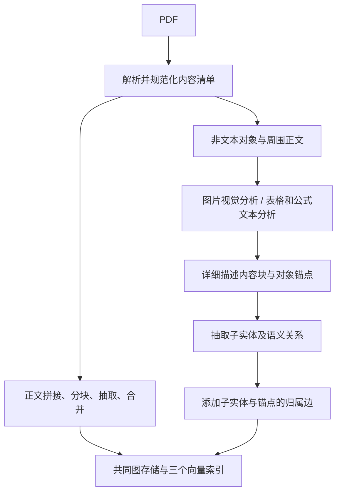

### 1. 最终构建的对象

论文把正文知识图和跨模态知识图融合，再为实体、关系、内容块建立向量索引。非文本对象产生两种表示：详细描述供抽取及内容检索；简短实体摘要供该对象的图节点使用。每个对象作为锚点，与它的细粒度实体通过 `belongs_to` 关联。[^1]

最终结果写成：

```text
索引 = 一张实体关系图
     + 内容块向量库
     + 实体向量库
     + 关系向量库
     + 原文、来源映射、缓存和处理状态
```

### 2. 整体执行顺序



### 3. MinerU 的内容结构转为统一列表


| PDF 中的内容     | 解析结果                                  |
| ---------------- | ----------------------------------------- |
| 标题、正文、列表 | 文字字符串，标题带层级信息                |
| 图片、图表       | 裁剪图片文件，以及识别到的图注            |
| 表格             | HTML 表格字符串，保留行列结构；另有裁剪图 |
| 公式             | LaTeX 公式字符串；可带裁剪图              |
| 位置信息         | 所属页面、页面中的矩形坐标`bbox`          |

minerU输出格式如下：

```
[
  [第一页的内容块1, 内容块2, ...],
  [第二页的内容块1, 内容块2, ...]
]
```

RAG-Anything 进一步整理后的格式。 把上面的嵌套列表摊平，并统一字段。例如，省略坐标、简化路径后:

```json[
  {
    "type": "text",
    "text": "实验结果",
    "text_level": 1,
    "page_idx": 0
  },
  {
    "type": "text",
    "text": "模型的准确率为90%。",
    "page_idx": 0
  },
  {
    "type": "image",
    "img_path": "<裁剪图的绝对路径>",
    "image_caption": ["图1：模型结构"],
    "page_idx": 0
  },
  {
    "type": "table",
    "table_body": "<table><tr><td>模型A</td><td>90%</td></tr></table>",
    "page_idx": 0
  },
  {
    "type": "equation",
    "text": "E=mc^2",
    "text_format": "latex",
    "page_idx": 0
  }
]
```

page_idx=0 表示第一页。图片保存为文件，JSON 记录路径；
表格保存为 HTML 字符串；
公式保存为 LaTeX 字符串。
这些解析结果随后交给 RAG-Anything，进行描述生成和实体、关系抽取。

### 4. 从统一列表分出正文与非文本对象

`separate_content_with_page_map()` 逐项扫描：

- 对 `type=text` 取非空 `text`，按顺序收集，最终以两个换行拼接成一整篇正文。
- 同时记录每段正文在拼接字符串中的字符区间和页码。
- 其余类型复制到 `multimodal_items`，附加 `_content_list_index`，保留它在原始列表中的位置。
- 对 image 另外计算 `_section_path` 和 `_neighbor_text`。

输入：

```text
正文A（第1页）
图片（第1页）
正文B（第2页）
表格（第2页）
```


| 返回值             | 内容                                             |
| ------------------ | ------------------------------------------------ |
| `text_content`     | `"正文A\n\n正文B"`，拼接好的正文字符串           |
| `multimodal_items` | 图片、表格等对象列表；图片额外附加章节和邻近正文 |
| `page_intervals`   | 每段正文在拼接字符串中的起止字符位置及页码       |

### 5. 正文重新分块（属于LightRAG）

LightRAG 在切分正文之前，已经将整篇拼接、清洗后的正文按 `doc_id` 保存进 `full_docs`，其次两份库的设置均为 `chunk_token_size=1200`、`chunk_overlap_token_size=100`。默认不传额外字符分隔符，因此整篇正文按 token 滑动窗口切分：

```text
步长 = 1200 - 100 = 1100
chunk 0：tokens[0:1200]
chunk 1：tokens[1100:2300]
chunk 2：tokens[2200:3400]
```

最后一块可不足 1200；每块内容会 `strip()`。这不是按每个 MinerU 段落建一个 chunk，也不是按每页建一个 chunk。因此 v1 的 122 个解析正文块最终只有 10 个正文检索块。

分块 tokenizer 默认是 LightRAG 的 `gpt-4o-mini` tiktoken 计数器。

### 6. 给正文 chunk 编号，并附上来源字段

分块器已经返回每块的 `content`、`tokens`、`chunk_order_index`。这里的 `content` 就是该 token 窗口解码并去除首尾空白后的正文字符串。

LightRAG 对每块正文执行：

```python
chunk_id = compute_mdhash_id(chunk["content"], prefix="chunk-")
# 等价于正常 UTF-8 文本下的：
# "chunk-" + MD5(content 的 UTF-8 字节)
```

然后以这个编号为键，构造内存中的 `chunks` 字典：

```text
chunks[chunk_id] = {
    content, tokens, chunk_order_index,
    full_doc_id: 所属文档编号,
    file_path: 来源文件路径,
    llm_cache_list: []
}
```

这几类记录的对应关系保留如下：


| 存储对象                   | 用什么作为键         | 保存什么                       |
| -------------------------- | -------------------- | ------------------------------ |
| `full_docs`                | 文档编号`doc_id`     | 整篇拼接、清洗后的正文         |
| `text_chunks`，即 chunk KV | 内容块编号`chunk_id` | 每块原文及来源字段             |
| `chunks_vdb`               | 同一个`chunk_id`     | 每块文字的向量及部分元数据     |
| `doc_status`               | 文档编号`doc_id`     | 处理状态、该文档包含哪些 chunk |

**输入**是第 5 点的分块结果，**输出**是带编号和来源的 `chunks` 字典；此时还没有实体、关系，下一步先保存这些块。

### 7. 保存正文 chunk、生成 chunk 向量，并更新处理中状态

接着第 6 点的 `chunks`，LightRAG 并行启动三项任务：


| 任务           | 写入位置                   | 写入内容                                  |
| -------------- | -------------------------- | ----------------------------------------- |
| 保存内容块     | `text_chunks`，即 chunk KV | 每块原文及第 6 点的元数据                 |
| 生成并保存向量 | `chunks_vdb`               | 嵌入模型读取每块`content`，返回向量       |
| 更新状态       | `doc_status`               | `status=processing`、chunk 数量及编号列表 |

代码 `await asyncio.gather(*first_stage_tasks)` 等待三项完成，再启动 `_process_extract_entities(chunks, ...)`，该函数继续调用 `extract_entities()`。实体关系抽取直接读取内存中 `chunks` 的原文。

这里已经生成了 **chunk 向量**。后面的实体向量、关系向量在对应节点和边写入时生成。

### 8. 为当前正文 chunk 构造首次抽取请求

`extract_entities()` 遍历正文 chunks，取出当前块的 `content` 和编号。它用共同的系统提示词规定实体类型、命名、关系和输出格式，将该块正文填入用户提示词的 `input_text`。

找到的系统提示词如下：

---角色---

你是一名知识图谱专家，负责从输入文本中抽取实体及其关系。

---指令---

**1．实体抽取与输出**

- **识别实体**：识别输入文本中定义清楚、有意义的实体。
- **实体信息**：对每个识别出的实体，抽取以下信息：
  - `entity_name`：实体名称。如果名称不区分大小写，将其中每个重要单词的首字母大写，即标题式大小写。在整个抽取过程中保持命名一致。
  - `entity_type`：使用以下类型之一对实体分类：`{entity_types}`。如果所有给定类型都不适用，不要新增类型，将其归为 `Other`。
  - `entity_description`：仅依据输入文本中的信息，对实体的属性和活动作出简洁而全面的描述。
- **实体输出格式**：每个实体占一行，共四个字段，用 `{tuple_delimiter}` 分隔。第一个字段必须是固定字符串 `entity`。

格式：

```text
entity{tuple_delimiter}entity_name{tuple_delimiter}entity_type{tuple_delimiter}entity_description
```

**2．关系抽取与输出**

- **识别关系**：识别此前已抽取实体之间直接、明确表述且有意义的关系。
- **多元关系拆分**：如果一句话描述了涉及两个以上实体的关系，将其拆分为多个二元关系，分别描述。
  - 例如，对于“Alice、Bob 和 Carol 合作开展 Project X”，根据最合理的二元解释，可以抽取“Alice 与 Project X 的合作关系”“Bob 与 Project X 的合作关系”“Carol 与 Project X 的合作关系”，或者“Alice 与 Bob 的合作关系”等。
- **关系信息**：对每个二元关系，抽取以下字段：
  - `source_entity`：源实体名称，必须与实体抽取中的命名一致。如果名称不区分大小写，使用标题式大小写。
  - `target_entity`：目标实体名称，必须与实体抽取中的命名一致。如果名称不区分大小写，使用标题式大小写。
  - `relationship_keywords`：一个或多个概括关系性质、概念或主题的高层关键词。同一字段中的多个关键词必须用英文逗号 `,` 分隔，**不能使用 `{tuple_delimiter}` 分隔这些关键词**。
  - `relationship_description`：简洁说明源实体与目标实体之间的关系性质，并明确解释两者为什么相连。
- **关系输出格式**：每条关系占一行，共五个字段，用 `{tuple_delimiter}` 分隔。第一个字段必须是固定字符串 `relation`。

格式：

```text
relation{tuple_delimiter}source_entity{tuple_delimiter}target_entity{tuple_delimiter}relationship_keywords{tuple_delimiter}relationship_description
```

**3．分隔符使用规则**

- `{tuple_delimiter}` 是一个完整、不可拆分的标记，不能向标记内部填入内容。它只能作为字段分隔符。
- 错误示例：

```text
entity{tuple_delimiter}Tokyo<|location|>Tokyo 是日本的首都。
```

- 正确示例：

```text
entity{tuple_delimiter}Tokyo{tuple_delimiter}location{tuple_delimiter}Tokyo 是日本的首都。
```

**4．关系方向与去重**

- 除非明确说明，否则将所有关系视为无向关系。对于无向关系，交换源实体和目标实体不构成一条新关系。
- 避免输出重复关系。

**5．输出顺序与优先级**

- 先输出全部抽取出的实体，再输出全部抽取出的关系。
- 在关系列表中，优先输出对输入文本核心含义最重要的关系。

**6．上下文与客观性**

- 所有实体名称和描述都应采用第三人称表述。
- 明确写出主体或客体的名称，避免使用“本文”“本论文”“我们公司”“我”“你”“他/她”等指代表达。

**7．语言与专有名词**

- 全部输出，包括实体名称、关键词和描述，必须使用 `{language}`。
- 对于人名、地名、组织名称等专有名词，如果没有恰当且广泛认可的译名，或者翻译会引起歧义，应保留原语言名称。

**8．完成标志**

只有在按照上述全部要求，完整抽取并输出所有实体和关系之后，才输出固定字符串：

```text
{completion_delimiter}
```

---示例---

{examples}

下一步把这个请求交给文本模型。**第 8—12 点是在每个 chunk 内依次执行的流程**；外层可以并发处理多个 chunk，不是先对全部块完成第 8 点，再统一进入第 9 点。

### 9. 调用文本模型，取得首次抽取响应

程序调用 `use_llm_func_with_cache()`：先按提示内容查抽取缓存；命中时复用响应，未命中时请求文本 LLM 并保存缓存。

首次响应是以下行协议：

```text
entity<|#|>实体名称<|#|>实体类型<|#|>实体描述
relation<|#|>源实体<|#|>目标实体<|#|>关键词<|#|>关系描述
<|COMPLETE|>
```

**输出是一段响应字符串**。代码接下来立即解析这段字符串：

### 10. 立即解析首次响应，得到当前 chunk 的候选字典

_process_extraction_result() 依次处理模型的字符串：

```text
按换行拆记录
    ↓
按 <|#|> 拆字段
    ↓
清洗字段
    ↓
检查格式
    ↓
整理为候选字典

```

把有效记录整理为：

```python
maybe_nodes[entity_name] = [实体记录, ...]
maybe_edges[(src_id, tgt_id)] = [关系记录, ...]
```

每条实体或关系记录同时附上 `source_id=当前 chunk_id`、`file_path` 和抽取时间。普通关系通常赋 `weight=1.0`。例如：

```python
# 省略部分字段
maybe_nodes = {
    "张三": [
        {
            "entity_name": "张三",
            "entity_type": "person",
            "description": "张三在北京大学工作。",
            "source_id": "chunk-A"
        }
    ]
}

maybe_edges = {
    ("张三", "北京大学"): [
        {
            "src_id": "张三",
            "tgt_id": "北京大学",
            "keywords": "任职",
            "description": "张三在北京大学工作。",
            "source_id": "chunk-A",
            "weight": 1.0
        }
    ]
}
```


| 名词或字段    | 含义                                               |
| ------------- | -------------------------------------------------- |
| `maybe_nodes` | 候选实体字典，按实体名称组织                       |
| `maybe_edges` | 候选关系字典，按两个实体名称组成的实体对组织       |
| 值中的列表    | 同名实体或同一实体对可能有多条记录，因此用列表收集 |
| `src_id`      | 关系源端的实体名称，例如“张三”                   |
| `tgt_id`      | 关系目标端的实体名称，例如“北京大学”             |
| `source_id`   | **证据来源的 chunk 编号**，例如 `chunk-A`          |
| `file_path`   | 来源文件路径                                       |
| `timestamp`   | 抽取时间                                           |
| `weight`      | 关系权重；普通关系通常为 1.0，不是置信概率         |

**这里还没有写入图。** 下一步才决定是否补抽取。

### 11. 补抽取一次，再解析响应并合并候选

默认开启一次补抽取。程序将首次请求和响应作为历史，要求模型补充遗漏或修正格式。补抽取请求超过配置的输入长度上限时跳过。

完整顺序是：

```text
第 9 点：首次响应
    ↓
第 10 点：首次解析，得到 maybe_nodes / maybe_edges
    ↓
补抽取请求 → 补抽取响应
    ↓
再次调用 _process_extraction_result()
    ↓
将补抽取候选并入首次候选
```

新名字、新实体对直接加入；重复实体或关系：比较两次描述的字符长度，保留更长的版本；长度相同保留首次版本。

**输出是当前 chunk 的最终候选字典**。下一步登记本块使用的缓存，再返回结果。

### 12. 回写缓存引用，并收集所有正文 chunk 的候选

首次抽取及补抽取产生的缓存键，按照顺序追加到该 chunk 的 `llm_cache_list`。模型原始响应保存在响应缓存中然后当前 chunk 返回 `(maybe_nodes, maybe_edges)`。外层等待所有块成功，形成 `chunk_results`：

```text
[
  (正文块 A 的候选实体, 正文块 A 的候选关系),
  (正文块 B 的候选实体, 正文块 B 的候选关系),
  ...
]
```

先保存 chunk 是为了让来源记录和缓存引用可回查；下一步 `merge_nodes_and_edges()` 才开始全局聚合、建图。

### 13. 聚合所有正文候选，形成待合并的节点组和边组

`merge_nodes_and_edges()` 收到第 12 点的 `chunk_results`，按两个键聚合：

```text
同一个 entity_name → all_nodes[entity_name]，收集各块对这个实体的记录

同一排序后的实体对 → all_edges[(较小名称, 较大名称)]，收集各块的关系记录
```

**输出是所有待写实体组与关系组。** 接下来先处理完所有实体组，再处理关系组；

### 14. 合并实体描述，写正文图节点并更新实体向量

对第 13 点的每个实体组，`_merge_nodes_then_upsert()` 依次执行：

1. 用名称读取已有图节点及已有来源。
2. 合并新旧来源，选择实体类型，整理描述和文件路径。如果记录给出的实体类型不同，按类型出现次数选择最终类型。
3. 描述少且短时直接拼接；达到数量或长度阈值时调用文本 LLM 生成合并摘要。
4. 将最终属性 `upsert_node(entity_name, node_data)` 写入图。
5. 将“实体名称 + 换行 + 最终描述”交给嵌入模型，更新 `entities_vdb`。

```text
候选实体组
  → 新旧描述合并/摘要
  → 图中的实体节点
  → 与这个节点对应的实体向量
```

全部实体组完成后进入关系阶段：

### 15. 合并关系描述，补齐端点，写边并更新关系向量

对每个关系组，`_merge_edges_then_upsert()` 依次执行：

1. 读取该实体对已有的边，合并新旧来源、关键词、权重和描述。
2. 汇集出处，去重关系关键词，将各条记录的权重相加，并整理关系描述。描述少且短就拼接，多或长就让文本模型归纳成摘要。
3. 检查两个端点；端点缺失时补建 `UNKNOWN` 节点并生成实体向量，端点已存在时按需追加关系来源。
4. `upsert_edge()` 写入最终边属性。
5. 将“关键词 + 两个端点 + 最终关系描述”交给嵌入模型，更新 `relationships_vdb`。

**输出是正文图中的边及对应关系向量。** 节点/边的摘要与向量化都发生在本次合并过程中

### 16. 完成正文阶段，保存索引并补正文页码

正文节点和关系处理完后，当前这次 `merge_nodes_and_edges()` 写入文档实体清单和关系清单。LightRAG 将正文阶段状态设为 `processed`，调用 `_insert_done()` 保存存储更新，正文插入返回。

随后 RAG-Anything 等待/确认正文处理完成，并执行 `_annotate_text_chunk_pages()`：使用第 4 点的 `page_intervals` 和相同分块规则，给可确认的正文 chunk 补上 `page_idx`、`page_idx_end`。然后将文档置为继续处理中，以便进入多模态阶段。

此时已经有：

```text
正文 chunks 及其向量
正文实体节点及其向量
正文关系边及其向量
正文来源和文档辅助索引
```

正文阶段到这里结束；下面才开始处理第 4 点留下的非文本对象：

### 17. 遍历非文本对象：选处理器、取上下文、生成文字描述并解析

`_process_multimodal_content_batch_type_aware()` 读取第 4 点保留下来的 `multimodal_items`。对每个对象按类型选择一种处理器：


| 类型           | MinerU 解析后的内容形式                                                             | RAG-Anything 处理器      | 调用模型     | 模型实际读取                                                                     | 返回内容                      |
| -------------- | ----------------------------------------------------------------------------------- | ------------------------ | ------------ | -------------------------------------------------------------------------------- | ----------------------------- |
| 图片`image`    | **裁剪图片文件**，JSON 保存 `img_path`；附带图注、可用脚注、页码等                  | `ImageModalProcessor`    | 视觉模型 VLM | 图片像素、图注、脚注、章节路径，以及按配置提取的周围正文                         | 图片详细描述 + 图片主实体信息 |
| 表格`table`    | **HTML 表格字符串**，保存在 `table_body`；另可保存表格裁剪图路径、表注、脚注等      | `TableModalProcessor`    | 文本模型 LLM | 表格结构与数值、表注、脚注、周围正文；裁剪图路径作为文字提供，**不读取其像素** | 表格详细描述 + 表格主实体信息 |
| 公式`equation` | **LaTeX 等公式字符串**，保存在 `text`，格式保存在 `text_format`；可带公式裁剪图路径 | `EquationModalProcessor` | 文本模型 LLM | 公式字符串、公式格式、周围正文，**不读取公式裁剪图像素**                       | 公式详细描述 + 公式主实体信息 |

每个对象收到模型响应后，处理器当场解析并校验：

```json
{
  "detailed_description": "该对象的详细说明",
  "entity_info": {
    "entity_name": "对象语义名称",
    "entity_type": "image/table/equation 中当前对象对应的类型",
    "summary": "该对象作为整体的摘要"
  }
}
```

正常解析后，名称增加类型后缀，如 `模型结构图 (image)`。**一个对象必须完成响应解析，才会返回该对象的说明结果**；

### 18. 收集说明结果，构造多模态 chunk

上一点的任务返回后，程序按原对象相对顺序收集成功的说明结果。对图片、表格和公式，通常一份对象说明对应一个 section、一个 chunk。

`_convert_to_lightrag_chunks_type_aware()` 将详细说明与原字段套入模板：

```text
图片 content = 章节 + 邻近原文 + 图片路径 + 图注 + 脚注 + 视觉详细描述
表格 content = 裁剪路径 + 表注 + 原始表结构 + 脚注 + 表格详细描述
公式 content = 原公式 + 格式 + 数学详细描述
```

再对**完整模板字符串**计算 `chunk- + MD5(content)`，记录 token 数、文档编号、对象类型、页码和 `modal_entity_name`。**输出 `lightrag_chunks` 字典**：

### 19. 保存多模态 chunk，并生成其 chunk 向量

`_store_chunks_to_lightrag_storage_type_aware()` 先将上一点的 `lightrag_chunks` 写入 `text_chunks`，再交给 `chunks_vdb` 嵌入并保存。

```text
多模态格式化文字
  → text_chunks：说明原文和元数据
  → chunks_vdb：说明文字的向量
```

这一阶段向量编码的输入是格式化说明文字；图片像素已经在第 17 点用于视觉分析。**输出是已保存的多模态内容块及其向量**。接下来建立代表对象整体的主节点：

### 20. 创建多模态主节点，并保存主实体向量

`_store_multimodal_main_entities()` 使用第 17 点返回的 `entity_info`。例如：

```text
节点键：模型结构图 (image)
entity_type：image
description：entity_info.summary
source_id：第 18 点的 chunk_id
file_path：源 PDF 路径
```

程序先写图节点，再把主实体摘要嵌入并写入 `entities_vdb`，同时将主节点加入文档实体辅助清单。**输出是已存在的主节点及主实体向量**，下一步从说明中抽取细粒度子实体、语义关系：

### 21. 对多模态 chunk 执行同一套实体关系抽取

`_batch_extract_entities_lightrag_style_type_aware()` 将第 19 点保存的多模态 chunks 交给同一个 LightRAG `extract_entities()`。

它重复第 8—12 点的流程：

```text
取完整多模态 chunk.content
  → 构造提示词
  → 文本 LLM 首次抽取
  → 解析候选
  → 可选的一次补抽取、解析与候选合并
  → 回写缓存引用
  → 返回各块的候选实体和关系
```

例如，`模型结构图 (image)` 是上一点已建好的主节点；这里才可能抽出 `编码器`、`解码器` 等子实体，以及二者的语义关系。输出仍是候选字典，下一步先添加归属边，再统一写图合并

### 22. 给多模态候选添加 belongs_to 归属关系

`_batch_add_belongs_to_relations_type_aware()` 根据 chunk 编号找到主实体名称，对候选实体添加：

```text
子实体 → belongs_to → 所属多模态主实体
```

例如：

```text
编码器 → belongs_to → 模型结构图 (image)
解码器 → belongs_to → 模型结构图 (image)
```

关系候选保存 `source_id=当前 chunk_id`，关键词为 `belongs_to,part_of,contained_in`，固定权重 10.0。相同主节点名称的实体排除自连接。

**输出是 `enhanced_chunk_results`：原来的候选实体、语义关系，加上自动归属关系**。它们接下来一起合并入图。

### 23. 将多模态候选合并进已有正文图，并更新向量

`_batch_merge_lightrag_style_type_aware()` 将上一点结果交给 `merge_nodes_and_edges()`，传入的是正文阶段已经使用的同一个图、实体向量库和关系向量库。

内部重复第 13—15 点的阶段：

```text
候选聚合
  → 实体新建/合并、描述整理、更新实体向量
  → 关系新建/合并、补齐端点、更新关系向量
```

正文图中的 `编码器` 与本次抽取的 `编码器` 名称一致时，更新同一个节点；已有语义边和本次归属边也按实体对写入这张图。

**输出是已经同时包含正文知识、非文本知识及归属连接的图和对应向量索引**。

### 24. 更新本次多模态文档辅助索引并保存

节点与关系合并后，同一次 `merge_nodes_and_edges()` 写入本批的文档实体、关系清单，随后 `_batch_merge_lightrag_style_type_aware()` 调用 `_insert_done()` 保存更新。

### 25. 整合文档 chunk 列表，标记多模态完成

图和索引合并返回后，`_update_doc_status_with_chunks_type_aware()` 将多模态 chunk 编号保序合并进原有正文 `chunks_list`，去重并更新数量。

批量多模态处理返回后，`_mark_multimodal_processing_complete()` 设置多模态完成标志，并完成文档状态更新。

```text
doc_status.chunks_list = 正文 chunk 编号 + 多模态 chunk 编号
multimodal_processed = True
status = processed（没有失败状态时）
```
